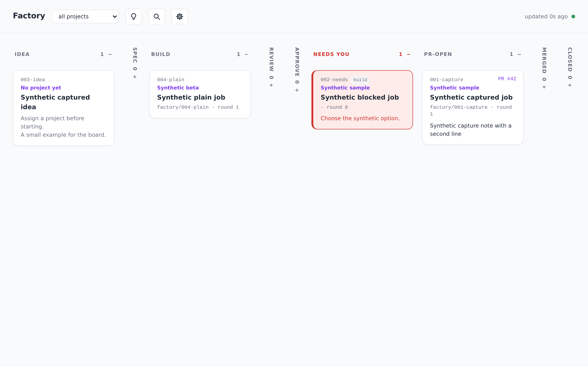
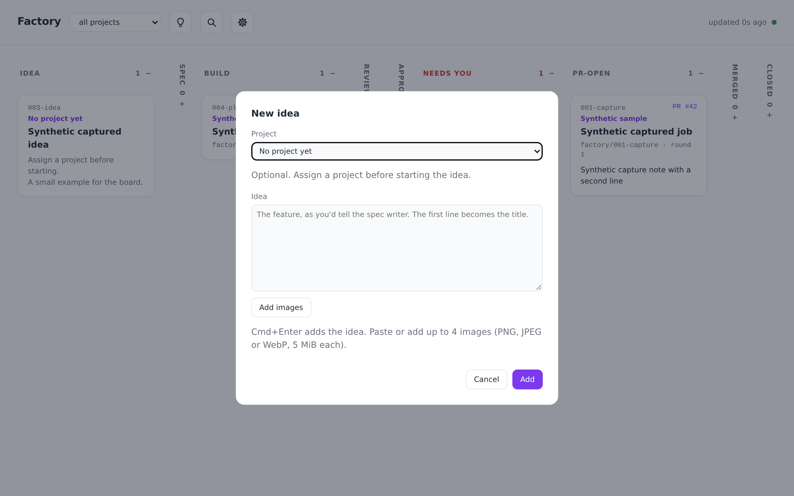
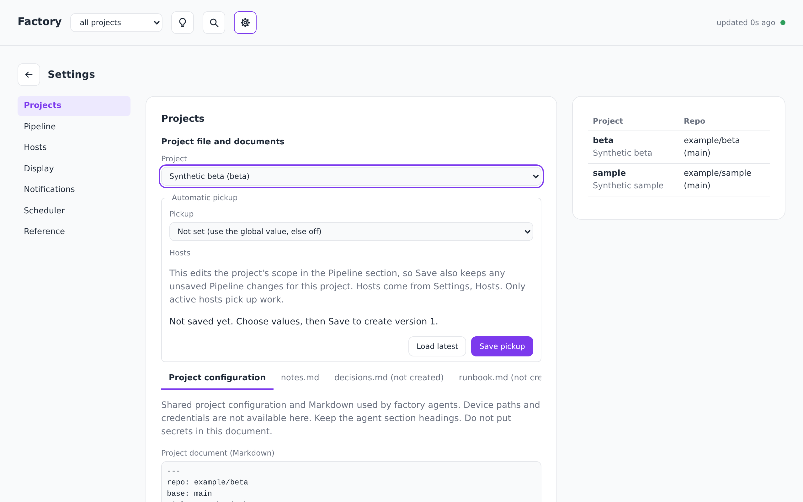

# factory

A portable software factory: a shared board, safe multi-device state, and a private self-hosted deployment on Cloudflare. This checkout contains everything another operator needs to run their own instance — the hosted Worker, dashboard and bundled assets, the portable device CLI, and the repository-owned deployment and verification tooling.

## Prerequisites

- mise (installs the development tools from `mise.toml`)
- Node `>=22.18.0` (development and verification are pinned to `24.14.0`; see `.node-version`)
- pnpm `11.9.0` (`package.json` `packageManager`)
- Python `3.8+` (standard library only)
- Git
- A Cloudflare account with an active zone (for deployment)

## Run your own instance

```sh
mise install
mise exec -- pnpm install --frozen-lockfile
mise exec -- python3 tools/bootstrap.py up
```

`bootstrap.py up` asks for your Cloudflare account ID, zone, factory hostname and allowed emails, then creates or reuses the R2 bucket, Access application, policies and this device's service token, writes `deploy/profile.json` and the device `.env`, and deploys. It reads the API token from `CLOUDFLARE_API_TOKEN` or a hidden prompt. Rerunning it creates nothing new. See [docs/cloudflare.md](docs/cloudflare.md#guided-setup) for token permissions, a second device and `down`.

## Develop

```sh
mise exec -- node tests/browser/provision.mjs   # one-time browser download; pnpm test and test:assets need it
mise exec -- pnpm test
```

The install uses public-registry tarballs with locked SHA-512 integrity values. It does not download a browser. Only esbuild `0.28.2` and workerd `1.20261023.1` may run install hooks; fsevents `2.3.3` is denied. Unreviewed hooks fail installation. See [docs/development.md](docs/development.md) for the installation policy and recovery.

## Local checks

`mise exec -- pnpm test` runs, in order: asset preparation plus a production dry-run and bundle verification, the production auth unit suites, the exact v1 protocol suites, the local integration check (`node tools/local.mjs --check`, which starts isolated local R2 on owned loopback ports and executes the HTTP suites plus the workerd auth-entry cases against real production crypto), the full browser suite matrix, and the deployment tooling tests. Use synthetic fixtures only; local tests bind `127.0.0.1:8220`/`8221` or owned ephemeral ports and never touch production. The device checks and installed Python bundle need no Node, pnpm or mise.

## Dashboard URLs

The dashboard loads at the origin root `/`. Historical `/dashboard.html` links redirect to the root, preserving the query string and the browser keeps the original fragment, so old board and document deep links keep working. There is no separate dashboard page.

## Affected checks

The four concerns are declared as Nx projects, so a change can run only what it touches:

```sh
mise exec -- pnpm exec nx affected -t auth protocol assets deploy local browser \
  --base="$(git merge-base origin/main HEAD)" --head=HEAD
mise exec -- pnpm exec nx run-many -t cli install verify
```

`worker-hosted` owns `auth` and `protocol`, `web-dashboard` owns `assets`, `tooling` owns `deploy`, `local`, `browser` and `verify`, and `skills/factory` is declared as `device-bundle`, whose Python suites run as the cached `cli`/`install` targets (and `tooling:verify`) through `nx run-many`; `tools/verify.py` still runs them directly with no Node. `worker-hosted`'s suites depend on `web-dashboard:assets` because they import the `.build` artifacts it writes, so a clean checkout builds assets first. Only `local` binds the fixed ports 8220/8221; `browser` uses owned ephemeral ports, so the two run side by side.

`nx` is a pinned devDependency; task results cache locally under the ignored `.nx/cache` (`pnpm exec nx reset` clears them), and `pnpm exec nx show projects` lists the four projects. Job 108 adds the lint and format targets later; `nx.json` deliberately declares none.

## Private deployment profile

All deployment input lives in the ignored `deploy/profile.json`. Copy the schema from `tests/fixtures/deployment-valid.json` (synthetic values that validate syntactically but belong to nobody) and fill in your own account, Worker name, R2 bucket, HTTPS origin, Access issuer and audience. Every schema key is required: `image_origins` (`[]`) and `agent_links` (`{}`) are the values that disable those integrations. Optional `jira_origin`, such as `https://your-site.atlassian.net`, turns Jira keys in job files into links to `<jira_origin>/browse/<KEY>`; leave it out to keep keys as text.

```sh
python3 tools/deploy.py check --profile deploy/profile.json
python3 tools/deploy.py render --profile deploy/profile.json
python3 tools/deploy.py dry-run --profile deploy/profile.json
```

`check` validates only; `render` writes the fixed Wrangler config and a nonsecret connection descriptor under `.build/`; `dry-run` never contacts production storage. `deploy/profile.json` is ignored and must never be committed.

## Deploy

Deployment is an operator-only gate: read the complete recipe — bucket creation, Access application and Service Auth policies, secret handling, and a disposable-instance release checklist — in [docs/cloudflare.md](docs/cloudflare.md). Every reviewed `main` push then deploys automatically from the `deploy-main` workflow; its one-time credential setup is [docs/cloudflare.md §8](docs/cloudflare.md#8-continuous-deployment-from-main).

## Screenshots







Captured by `tools/capture-screenshots.mjs` with synthetic fixture data (frozen clock, placeholder URLs only).

## More

- [docs/architecture.md](docs/architecture.md) — ownership, request boundary, protocol, toolchain and bundle proofs
- [docs/configuration.md](docs/configuration.md) — configuration layers, precedence and the secrets boundary
- [docs/trust.md](docs/trust.md) — trust model for configurable text
- [docs/cloudflare.md](docs/cloudflare.md) — operator recipe for a new Cloudflare instance
- [docs/device.md](docs/device.md) — device setup, credentials and reconciliation
- [docs/integrations.md](docs/integrations.md) — optional native roles, model selection, schedules and the Tracer mirror
- [docs/development.md](docs/development.md) — repository development, checks and the verify groups
- [docs/upgrade.md](docs/upgrade.md) — upgrading a running instance to merged source
- [docs/config-changes.md](docs/config-changes.md) — previewing, applying and rolling back config and URL changes
- [docs/recovery.md](docs/recovery.md) — backup gate and recovery boundaries
- [docs/autonomy.md](docs/autonomy.md) — explorer suggestions, the autonomy kill switch and human-only approval
- [docs/troubleshooting.md](docs/troubleshooting.md) — Access, port, provisioning and sync-conflict fixes
- [docs/public-cutover.md](docs/public-cutover.md) — moving the private repository to a fresh public one

## License

MIT. See [LICENSE](LICENSE). Bundled third-party code keeps its own license; see [THIRD_PARTY_NOTICES.md](THIRD_PARTY_NOTICES.md).
