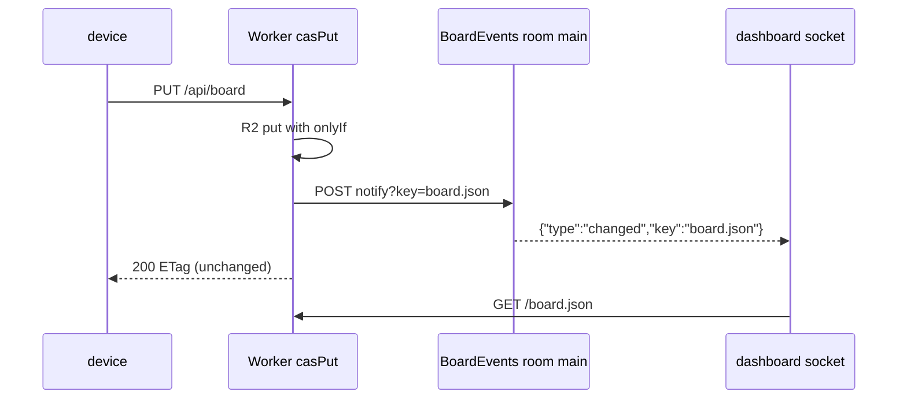

# Architecture

The device runtime and installed roles belong to `skills/factory/`. Worker, web,
tools and tests remain outside that installed bundle. Source updates, installed
skill refreshes and hosted deployments are separate operations. None resets state.

The production request boundary validates public server configuration and exact
origin, verifies Access RS256 assertions against the configured issuer's JWKS,
then dispatches the v1 API or fixed page/assets. No cookie or device metadata is
an origin identity. JWKS resolvers live in memory per issuer for ten minutes, with
a five-second timeout and refresh cooldown. Failures disclose no verifier details.

## Toolchain

Node `>=22.18.0`, pinned development Node `24.14.0`, pnpm `11.9.0`.
`mise install` provisions the pins from `mise.toml`;
`mise exec -- pnpm install --frozen-lockfile` installs dependencies.
Direct pins are jose `6.2.13`, Wrangler `4.154.0`, Mermaid `12.2.0`, esbuild
`0.28.2`, puppeteer-core `25.16.0`, @puppeteer/browsers `3.2.6` and test-only
YAML parser `2.9.1`.
Only jose is a production dependency. The lock records exact registry integrity
for every dependency; browser installation is a separate explicit operation.

`pnpm install --frozen-lockfile` is not offline or hook-free. Reviewed locked
install hooks are esbuild's `node install.js` and workerd's `node install.js`.
They resolve the locked optional
platform binary, check its version and may link it into the package. If that
optional package is missing, upstream installers can invoke npm or download from
the npm registry. esbuild additionally verifies the binary's SHA-256. Do not omit
optional dependencies or supply binary-path overrides for verification.

The lock also marks macOS-only fsevents `2.3.3` as having an install script; its
shipped manifest has no install/postinstall hook and includes a native binary.
Its build/prepublish scripts are publisher tooling, not project lifecycle hooks.
There are no project install/preinstall/postinstall scripts and puppeteer-core
does not install Chrome. The explicit browser provisioner is a separate network
step. The root-only pnpm workspace uses isolated linking, explicit public tarball
URLs and SHA-512 integrity. Its strict build policy permits only esbuild `0.28.2`
and workerd `1.20261023.1`, denies fsevents `2.3.3` and disables the side-effects
cache. Stale dependencies stop scripts rather than installing implicitly.
Rollback means reinstalling from the previous checkout's lockfile, not migrating
device data. Locked integrity for the reviewed hook-bearing packages:

| Package | Registry SHA-512 integrity |
| --- | --- |
| esbuild 0.28.2 | `sha512-HKVLS8dvII+xoKW9kmqxbRKrnWEXfJJr/FZhhJmiqIB0e053QNYFqOBouTMO/k5sID4MvCiUCvv8b9M4h32wIA==` |
| workerd 1.20261023.1 | `sha512-NeofJFyaYNpqKpFRJW3ApuonaerPd6/JWlfTtLDYf2A6ygqrDEFnYgEXmc0hhOxqnJsSM+kXJN6VebPojzRrsg==` |
| fsevents 2.3.3 | `sha512-5xoDfX+fL7faATnagmWPpbFtwh/R77WmMMqqHGS65C3vvB0YHrgF+B1YmZ3441tMj5n63k0212XNoJwzlhffQw==` |

## Ownership

| Area | Owner |
| --- | --- |
| Device runtime and installed bundle | `skills/factory/` (merged 086): skill, nine roles, references, schedules, installer. Contains no Worker, web, browser or deployment file. |
| Hosted Worker/dashboard/assets | `worker/`, `web/`, imported text, fixed asset allowlist, v1 R2 keys and browser storage. |
| Pipeline configuration | Hosted Worker: R2 `pipeline/` (current global and per-project documents) and `pipeline-history/` (create-only copy of every saved version). `worker/admission.js` holds the schema, text admission and security floors; see [trust.md](trust.md). Nothing is deleted; recovery is a forward save of an old version. |
| Archived jobs | Hosted Worker only: `worker/archive.js` runs hourly (cron `17 * * * *`) when the global pipeline sets `archive`. It writes R2 `board-archive.json` first, then removes the moved rows from `board.json` and updates the board's top-level `archived` field (`max_id`, `fingerprints`). Clients round-trip `archived` unchanged; a board write that changes it, or adds an id up to `max_id`, gets a 400. `GET /api/board/archive` reads it by `id`, `page` or `q`. `q` matches id, title, project, Jira key, PR link and idea text. Job files stay where they are. A refused write makes the pass return `conflict` and log a `console.warn` that starts `archive pass conflict:` and names the key, visible in `wrangler tail`. The dashboard's "Show archived jobs" button under the merged and closed columns, and on the "No jobs yet" board once `archived` is set, pages it 50 rows at a time. A failed page shows its error under the clicked column and announces it once in the board status. |
| Project files and documents | Hosted Worker: R2 `projects/<slug>.md` and `project-documents/<slug>/<name>` (current), and `project-history/<slug>/<name>/` (create-only copy of every saved version, `<name>` being `project.md`, `notes.md`, `decisions.md` or `runbook.md`). An object saved before history existed counts as version 1. Nothing is deleted; recovery is a forward save of an old version. |
| Deployment tooling | `tools/deploy.py`, `tools/assets.mjs`, `tools/local.mjs`, private profile and generated production config/connection descriptor. |
| Verification | `tests/worker/`, `tests/browser/`, hosted `tests/support/`, hosted fixtures, `tests/tools/`. |
| Documentation | `README.md`, `docs/architecture.md`, `docs/cloudflare.md`, `docs/device.md`, `docs/integrations.md`, `THIRD_PARTY_NOTICES.md`. |

Source merge (Git), installed skill refresh (`tools/install.py`) and hosted
deployment (`tools/deploy.py deploy`) are three distinct operations. None runs a
migration or reset; installing or deploying never rewrites existing state.

## v1 protocol and storage

The Worker preserves the v1 wire and storage contracts: exact routes, status
codes, bodies, header order, validation order and limits. Text resources are
capped at 1 MiB (board and backlog at 4 MiB), images at 5 MiB (declared-length and streamed), image envelopes
at 4096 pixels per side and 16,000,000 pixels. Storage keys, `httpEtag` handling,
quoted ETags, uppercase weak `W/` normalization, 412 on null conditional puts,
original-byte hashes, no CORS headers, no delete endpoint and no pagination
remain unchanged. The route map and per-route behavior are asserted in
`tests/fixtures/protocol-v1.json` and the ported suites under `tests/worker/`.

One deliberate exception: **job file PUTs (`/api/jobs/...`) accept absent
conditions** for legacy-client compatibility (a blind write), while malformed
present conditions return 428. Project files, board and backlog keep strict
conditional semantics. A board write that names the stored version also
cannot change a row's id: one write may not drop a stored id and add a row.
It also cannot add `move`, `priority`, `paused` or `close` to a row with a
`batched-into` ref, since a rider follows its lead.
New device clients always send conditions; the blind
write remains an honest compatibility surface, unsafe under concurrent writers.

Pipeline configuration routes are additive and change no existing route:
`GET`/`PUT /api/pipeline/global` and `/api/pipeline/projects/<slug>`,
`GET /api/pipeline/history/<scope>` and `/api/pipeline/history/<scope>/<n>`, and
`GET /api/pipeline/effective/<slug>`. PUTs are strict-conditional, capped at
16 KiB, accepted only from an Access-authenticated person, and validated by
`worker/admission.js`. The one exception is `PUT /api/pipeline/retro/<scope>`,
which a bound host's service token uses to replace a single stage note. Each save bumps
`X-Pipeline-Version`. Project-scoped routes return 404 for an unregistered slug,
and the effective view returns 409 when a stored document no longer validates.
The effective view also lists the switched-on gate stages from the code catalog.
The history list carries `saved_by` only for a person principal. Each entry
carries `summary` (`""` when none), and a retro version also carries `run` and
`host`. A person's PUT may send `X-Pipeline-Summary`, percent-encoded. Each entry's
`history_copy` says whether its create-only copy exists. A PUT whose copy failed
answers `X-Pipeline-History: missing`. Devices read only the effective view,
through `factory.py pipeline <slug>`.

Project file and document PUTs keep every saved version the same way. Each save
answers `X-Project-Version` and may send `X-Project-Summary`, percent-encoded; a
device save is recorded as `saved_by: "device"`. `GET /api/project-history/<slug>/<name>`
lists the versions newest first and `GET /api/project-history/<slug>/<name>/<n>`
returns one version's exact bytes. Both are GET only and return 404 for an
unregistered slug or unknown name. A PUT whose copy failed answers
`X-Project-History: missing`. Settings, Projects lists that history and restores an
old version to the draft.

The dashboard's Settings page (`#/settings/pipeline`) edits these documents per scope, lists
history and restores an old version as a forward save. The local test entry
signs in as the synthetic person `operator@example.test` so saves work under
the owned fixture.

Host registry routes are additive too. Each host has a person-owned
`hosts/<id>.json` and a device-owned `host-status/<id>.json`. The Worker owns
`host-pairing/<id>.json`, which holds only the SHA-256 of a pairing code and
its expiry. Bodies are `application/json` and capped at 16 KiB. Every other
method or path under `/api/hosts` returns 404, and no route deletes a host.

| Route | Who | Effect |
| --- | --- | --- |
| `GET /api/hosts` | any verified principal | hosts sorted by id, with `status`, `offline`, `etag` and `token_tail`; never `token` or `created_by` |
| `POST /api/hosts` | person | create a pending host; 201 with a one-time code |
| `PATCH /api/hosts/<id>` | person, `If-Match` | `label`, `max_inflight` (0 to 5), confirm (`paired` to `active`) or retire |
| `POST /api/hosts/<id>/code` | person | new code; a pending or retired host becomes pending and unbound |
| `POST /api/hosts/<id>/pair` | service token with a client id | a pending host becomes paired and bound to that token |
| `PUT /api/hosts/<id>/status` | the bound service token | write the status record; the Worker sets `seen` |
| `GET /api/hosts/<id>/history` | person | every saved version of the host, newest first, with `saved_by` and `saved_at` |

Retro digest routes store one redacted JSON-lines file per host per day at
`retro/<id>/<date>.jsonl`, where the date is the host's local date. The bound
host owns its file and nothing else writes the key. The body is at most 1 MiB of
UTF-8, and each line is a JSON object whose `host` is the route's id. A bad id
or calendar date answers 404, as does every other method. A PUT dated outside
yesterday, today or tomorrow in UTC answers 400. No route deletes a digest. The
hourly scheduled pass deletes digests dated more than 35 days before today's UTC
date.

| Route | Who | Effect |
| --- | --- | --- |
| `PUT /api/retro/<id>/<date>.jsonl` | the bound service token of a paired or active host | store or replace that host's digest for the date |
| `GET /api/retro/<date>` | any service token | JSON list of host ids with a digest that day, in host record order |
| `GET /api/retro/<id>/<date>.jsonl` | any service token | that host's digest as `application/x-ndjson` |
| `PUT /api/pipeline/retro/<scope>` | the bound service token of a paired or active host, while autonomy runs, for an allowlisted project scope only (never `global`) | replace one stage note as the next pipeline version, saved by `retro`; see [autonomy.md](autonomy.md#retro-pipeline-edits) |
| `PUT /api/project-retro/<slug>/<name>` | the bound service token of a paired or active host, while autonomy runs, for an allowlisted project only | splice one find-and-replace into a project file or document as the next version, saved by `retro`; see [autonomy.md](autonomy.md#retro-file-edits) |

Retro runs are stored one record per run at `retro-runs/<run>.json`. The hourly scheduled pass deletes a record uploaded more
than 90 days before today's UTC date; a re-admit resets that clock. `retro admit` sends a `factory.retro-run/1` record with the checked findings, each
card's `finding` link (one number or a list; a card linked to several findings is stored under each) and its outcome. The body is at most 64 KiB, `host` must be the bound
host, and a bad shape answers 400. A re-admit from the same host replaces the record. A PUT for a run another host stored answers 409 `retro run belongs to another host`. A PUT that loses a write race on its own host's run answers 409 `retro run changed, retry`; run `retro admit` again. The
`#/retros` dashboard page reads the newest 30 and resolves each card's status from the board and
the backlog.

| Route | Who | Effect |
| --- | --- | --- |
| `PUT /api/retros/<run>` | the bound service token of a paired or active host | store that run's record, or replace it when this host stored it |
| `GET /api/retros` | any verified principal | JSON array of the newest 30 run records, newest first |

The status may carry `triage_failed_since`, an ISO 8601 UTC time, while
backlog triage fails on that host.

A pairing code is ten characters shown as `XXXXX-XXXXX` and lasts 15 minutes.
Any pair attempt uses it up, and every failure answers the same 403. One
service token binds at most one host that is not retired. Retiring clears the
binding. A host is `offline` when it has no status or its `seen` is over 30
minutes old. A service token never creates, confirms or edits a host, and the
status `routes` list is a read-only copy that nothing routes from.

Each person write (create, PATCH, new code) bumps the record's `version` and
writes a create-only copy to `host-history/<id>/<version>.json`. Pairing is a
Worker write and keeps the version. Host replies never carry the bound client id
or the creator's email.

Cutover: while no `hosts/` object exists, the effective view passes
`pickup.hosts` through unchanged. Once the first host is registered, it keeps
only hosts in the `active` state, so register and confirm every host in one
sitting. Until the device pairing command ships, do not create a host, or
pickup stops on every host that is not yet active. Retiring a host does not
turn the filter off. To return to pass-through, delete every `hosts/` object
from the bucket. Stored pipeline documents and `GET /api/pipeline/<scope>` are
not filtered. The effective view also lists the active hosts as
`active_hosts: [{id, label}]`.

## Configuration and state ownership

- `deploy/profile.json` (ignored) is the only deployment input. Generated
  production config and the connection descriptor live in the ignored `.build/`.
- Server configuration reaches the Worker as `FACTORY_ORIGIN`, `FACTORY_TITLE`,
  `ACCESS_ISSUER`, `ACCESS_AUDIENCE`, `FACTORY_IMAGE_ORIGINS` and
  `FACTORY_AGENT_LINKS` (arrays/maps JSON-encoded). Missing required values fail
  closed as `factory unavailable`; optional policies default to disabled only
  when absent.
- Device state (config, `.env`, drafts, `.remote`, sync manifests) lives in the
  device's factory home and Git checkouts, owned by the device runtime.
  Deployment and installation never read or write it.
- Test persistence is isolated: fresh `.context/<run-id>/r2`, loopback-only
  bindings, and the fixed test entry `tests/support/wrangler.json`. Production
  never imports a test entry.
- Every configuration layer, its precedence and the secrets boundary are listed in [configuration.md](configuration.md).

## Imported text delivery and size proof

Mermaid is served from the bundle, same-origin and authenticated, at
`/assets/mermaid.min.js`, with `THIRD_PARTY_NOTICES.md` served at
`/assets/third-party-notices.txt`. `prepareAssets()` verifies the pinned
`node_modules/mermaid/dist/mermaid.min.js` byte-for-byte (5,494,801 raw bytes,
SRI `sha384-8xUhuLNMjW/cI2Dacg3DR4WliYznvIg0LVG1stctThKD/YVrJFI9TNCFxft5NYgp`)
and copies it and the notices into ignored `.build/` text imports.

`inspectBundle` inventories the actual Wrangler dry-run module set (page, auth
code, imported Mermaid and notices), hashes module bytes and reconciles its
per-module gzip sum (Node `zlib`, level 9) with Wrangler's reported compressed
upload size plus a declared rounding allowance. The complete-Worker gzip result
must stay within the 3,000,000-byte ceiling; an unexplained discrepancy fails
rather than loosens. The measured limit result is recorded in
`.build/assets.json` (current: 1,631,898 of 3,000,000 bytes).

## Live board events

The `BoardEvents` Durable Object (`worker/events.js`, a plain Durable Object on the WebSocket
Hibernation API) tells open dashboards when `board.json` or `backlog.md` changed. It
stores nothing and never carries board content. The room holds at most 100 open sockets
and answers a further upgrade with 503.

- `casPut` announces only a committed write. A 412 announces nothing, and a
  failed announcement leaves the reply unchanged.
- The dashboard runs its poll timer only while the socket is closed: the board on
  the Settings schedule (30 s by default) and the backlog every 2 minutes, paused
  while the window is hidden or unfocused unless notifications are on. A dropped
  socket retries with backoff (1, 2, 4 ... 30 s), then every 30 s until it opens.
  Retries stop while the sign-in has expired and resume after the next board read
  succeeds.
  A hidden tab keeps its socket only while notifications are on. A `changed` event
  re-reads only its key, once within 2 seconds of the first frame however many frames arrive; a frame during that read adds one more read.
- A socket open or a poll timer tick re-reads `board.json` but redraws only when its `ETag` changed, so a focused card is not read again. A tick still reopens the job when the link names a tab or archived job that has not loaded.
  The header dot is solid while live and a ring while polling.

| Request to `/events/board` | Result |
| --- | --- |
| no Access assertion | 403, before routing |
| GET without `Upgrade: websocket`, or POST | 404 |
| service token principal | 404 |
| `Origin` other than the request origin | 403 |
| user, same origin, upgrade | 101 from the room |

An open dashboard socket sends `ping` every 25 s. The room answers `pong` through `setWebSocketAutoResponse`, which does not wake it, so proxies that close quiet connections keep the socket. A socket with no `pong` for 60 s is closed and the tab polls. While polling, the dot's title names how the last socket closed: code, reason and time open, or that it never opened.

## Draft preservation

The dashboard keeps draft state in browser-local records keyed
`factory-project`, `factory-project-draft:<slug>`,
`factory-project-draft:<slug>:<name>` and `factory-project-document-draft:<slug>:<name>`,
with the original schemas (`{version,baseText,baseEtag,draftText}` and the
document variant with `blocked`). A missing observed baseline persists `blocked`
immediately; only an explicit validated Load latest replacement changes a
blocked base. Failed, denied, lost-response and polling races never clear a
block. The draft state machine, recovery copy and per-resource completion guards
are asserted in the browser and VM suites.

Pipeline settings keep one tab-scoped record per scope in `sessionStorage` at `factory-pipeline-draft:<scope>`, shaped `{format,scope,base,baseEtag,version,draft,conflict}`. A malformed record is never submitted, and only Load latest clears it.
