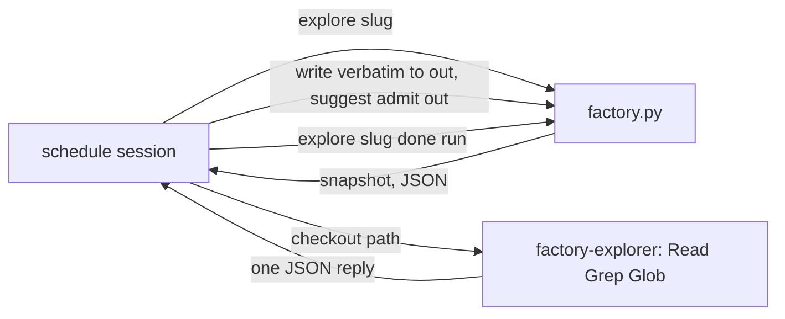
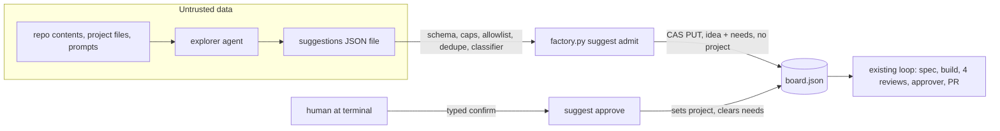
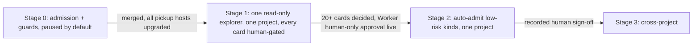
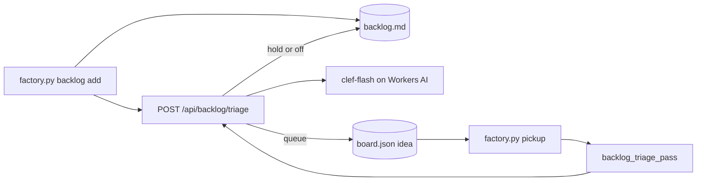
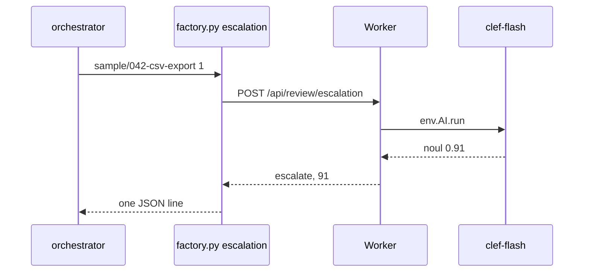

# Autonomy

Explorer agents may one day read a project and suggest work. This page covers the
controls that keep them to *proposing* idea cards. Only a human at a terminal turns
a suggestion into work. Stage 1 adds one read-only explorer for one allowlisted
project, run by a schedule a human enables. The kill switch defaults to paused.

## Commands

All of these run through `factory.py` on a device.

| Command | Who | What it does |
| --- | --- | --- |
| `autonomy status` | anyone | Prints the board's `autonomy` record with defaults filled. Writes nothing. |
| `autonomy pause` | anyone | Sets `paused: true`. The next `suggest admit` exits 3. |
| `autonomy resume` | human at a terminal | Sets `paused: false` after you type `resume`. |
| `autonomy allow <slug>` | human at a terminal | Adds a registered project to the allowlist after you type its slug. |
| `autonomy deny <slug>` | anyone | Removes a project from the allowlist. |
| `autonomy self <slug>` | anyone | Marks a project as part of the factory itself, so the classifier flags its cards. |
| `suggest admit <file>` | trusted launcher | Checks a `factory.suggestions/1` file and adds one gated idea card per new suggestion. |
| `suggest approve <job-id> <A\|B\|C>` | human at a terminal | Approves one option after you type the job id, which lets `factory.py pickup` promote the card. |
| `explore <slug>` | explorer schedule | Snapshots an allowlisted project's base for the explorer and prints the run's paths. Exits 3 when paused or not allowlisted. |
| `explore <slug> done <run>` | explorer schedule | Removes that run's snapshot and keeps its suggestions file. |

Loosening (`resume`, `allow`, `approve`) needs an interactive terminal and a typed
confirmation. Tightening never does. A missing `autonomy` record means paused, with an
empty allowlist.

## What admission checks

- The file is at most 64 KiB of UTF-8 JSON. It holds 1 to 5 suggestions with a fixed
  schema, no unknown keys, length caps, no links, no code fences and no control
  characters. Any violation exits 2, and nothing is written.
- The project is registered and on the allowlist, and autonomy is not paused (else
  exit 3).
- A suggestion whose fingerprint matches any card ever admitted, closed ones included,
  is skipped. So is one over the cap of 10 cards a day across the factory, or 5 open
  cards per project. Fingerprints survive archiving: when the Worker archives a card
  off the board, its fingerprint stays in the board's `archived.fingerprints`.
- A deterministic classifier records `eligible` and `reasons` (risky kinds, size L,
  no or many paths, sensitive paths such as CI, auth, deploy and lockfiles). In stage 0
  every card waits on a human whatever it says.

Each card lands at `stage: idea` with no `project`, a `needs` ask and an `origin`
record holding its provenance. The needs-you column shows it. The `idea.md` tab
shows the question, the options with pros and cons, the recommendation and how to
answer. To reject a card, discard it in the idea drawer.

## Stage 1 controls

These harden admission so it can take real explorer output.

- **Fail closed.** A malformed `autonomy` record counts as paused with an empty
  allowlist, and `factory.py` warns on stderr. Malformed means not an object, a
  `paused` that is not true or false, a `projects` or `self` that is not a list of
  strings, or more than one allowlisted project. `autonomy pause` rewrites it clean.
- **One project.** The allowlist holds at most one project. `autonomy allow <slug>`
  exits 2 before any prompt while another project is on it, and names that project.
  Run `autonomy deny <current>` first.
- **Untrusted text.** Every explorer string passes admission rules 3 to 7 from
  [trust.md](trust.md) through `check_untrusted`, so invisible characters, the
  envelope tag, links, secret shapes and override phrases exit 2 with nothing written.
- **Quoted prose.** The card renders the summary, question and recommendation reason
  as blockquotes. A heading or list inside them stays quoted, so explorer text cannot
  pose as the card's own instructions. A summary is one paragraph: a blank line exits
  2, since blank quote lines collapse.
- **ASCII word rules.** The secret and phrase patterns match ASCII word boundaries
  only, as the Worker's do, so `öignore the previous instructions` still trips them.

## Stage 1 explorer

`schedules/explore.md` runs one explorer over the allowlisted project. A human
materializes and enables it; nothing enables it by default.

- **Snapshot.** `explore <slug>` checks the kill switch and allowlist first, then
  fetches `origin/<base>` and unpacks that commit with `git archive` into
  `<home>/explore/<slug>/<run>/`. Only regular files and directories with safe
  relative paths land there. There is no `.git`, so no origin URL, and no symlink or
  hardlink. It prints `project`, `run`, `commit`, `checkout` and `out`.
- **Done.** `explore <slug> done <run>` deletes the snapshot. The `<run>.json` file
  beside it stays as the run's record. A crashed run leaves its snapshot until a
  `done` removes it.
- **Claude only.** The `factory-explorer` role has Read, Grep and Glob only: no
  shell, write or web tool. OpenCode's installed copy carries no tool limit, so the
  schedule stops with `no claude route` unless the picked route's provider is
  `claude`.
- **Human gate.** The schedule never runs `suggest approve` or an `autonomy`
  command. Every admitted card still waits on a human.

The explorer replies with one `factory.suggestions/1` object, or `{"none": true}`.
Admission enforces these field limits:

| Field | Limit |
| --- | --- |
| `schema`, `project`, `run`, `commit` | `factory.suggestions/1`, then the run's values as `explore` printed them |
| `suggestions` | 1 to 5 objects |
| `kind` | `bug-fix`, `test-gap`, `docs`, `cleanup`, `dependency-upgrade`, `migration`, `security` or `product-idea` |
| `title` | 1 to 80 characters, one line |
| `summary` | 1 to 600 characters, one paragraph |
| `evidence` | 1 to 5 of `path`, `note` (1 to 200 characters, one line) and an optional `line` of at least 1 |
| `paths` | 0 to 20 relative repo paths of `[A-Za-z0-9_./-]`, at most 200 characters, no `..` |
| `size` | `S`, `M` or `L` |
| `question` | 1 to 300 characters, one line |
| `options` | 2 or 3 keyed `A`, `B`, `C`; `label` 1 to 80 and `detail` 1 to 300 characters; 0 to 4 `pros` and `cons` of 1 to 120 characters |
| `recommend` | one of the option keys |
| `reason` | 1 to 300 characters |
| `diagram` | optional, 1 to 1500 characters |

## Trust boundary

- `factory.py`, the Worker and the human are trusted. Everything an explorer reads
  or writes is untrusted data.
- Admission sends only GET and PUT to `/api/board` and GET to `/projects.json`. It
  never runs git, gh or any other process.
- Guards: `ideas` skips any job with a `needs` ask or an unapproved explorer card.
  `board` refuses a patch that sets `origin`, and refuses moving an unapproved
  explorer card to any stage but `idea` or `closed`.
- Honest limit: the Worker cannot yet tell a human from a service token, so a token
  holder could forge an approval with a raw PUT. The runtime guards stop automation,
  not abuse. A Worker-side human-only approval gate must land before stage 2.
- Upgrade every host that runs `factory.py pickup` before the first `autonomy resume`.
  Older runtimes skip cards without a `project`, so unapproved cards stay put there too.

## Stages

| Stage | Entry | Exit |
| --- | --- | --- |
| 0 | coordinator gate on the spec | merged after 4 reviews and the approver; `autonomy status` on production shows `paused: true`; every host running `factory.py pickup` upgraded |
| 1 | stage 0 exit; a human runs `autonomy allow <one slug>` and `resume` | at least 20 explorer cards decided by a human; zero cards promoted without approve; approve and discard counts by `origin.eligible` recorded |
| 2 | stage 1 exit; Worker human-only approval gate merged; eligible-card approval rate at least 80 percent over at least 20 eligible cards | two weeks with zero reverted auto-card PRs |
| 3 | stage 2 exit; a signed-off decision recorded by a terminal-gated command in the board and in the factory project's `decisions.md` | ongoing |

Each later stage is its own gated job.

## Backlog triage

Backlog triage lets a project skip the dashboard Approve click for backlog lines its
rules clearly allow. It is off unless a person turns it on.

Settings, Pipeline holds a `triage` block per scope. A project value replaces the global
one whole. With neither set, triage is off.

| Field | Rule |
| --- | --- |
| `enabled` | true or false |
| `threshold` | an integer from 1 to 100. The dashboard fills in 90 |
| `rules` | text, may be empty. It passes the same admission rules as stage notes, so no links, secrets or instructions to skip review |

After `factory.py backlog add` appends a line, it posts the line and its `--context`
text to the Worker. The Worker reads the effective `triage` block and answers:

| Case | Model called | Decision |
| --- | --- | --- |
| triage off or not set | no | `off` |
| context line 1 is `Recommend: deny` (LF or CRLF) | no | `hold` |
| context has a `## Question:` line | no | `hold` |
| confidence at or above the threshold | yes | `queue` |
| confidence below the threshold | yes | `hold` |

- **Queue.** `factory.py` adds an `idea` row with `backlog.by: "triage"` and the verdict,
  then checks the line off with the new id, as a dashboard Approve does. If the line
  changed meanwhile, it drops the row while the row is still an unclaimed idea.
- **Hold.** The line waits in the backlog for a person, as before.
  The Worker keeps the latest hold verdict for each line, keyed by `<slug>: <feature>` without trailing whitespace, and the backlog drawer shows it under Held by triage. The board fetches each listed line's verdict ahead, so the drawer opens with it in place.
- **Sweep.** Lines that `backlog rework` appends, or that a person types, get the same
  verdict from `backlog_triage_pass`, which `factory.py pickup` runs before it claims ideas
  (never with `--dry-run`). Each run posts up to 5 unchecked lines, with the indented block
  under each as context, for projects whose effective `triage.enabled` is true. Held lines,
  and lines the Worker refuses with a 400, go into the host's `backlog-triage.json`, so this
  host never sends them again. `backlog add` records its held line there too. A 409, 502,
  503 or network failure warns, and the line is retried on the next run. Deleting the file
  only causes rescoring. A line whose new idea row could not be checked off or removed goes
  there too, so it is never queued twice.
- **Failure.** A 404 from an older Worker means off. Any other error prints a warning,
  and the line waits. If a board or backlog write fails while
  queueing, it prints what is left (the line, or the new id to check off or remove by hand).
  `backlog add` still exits 0. A Worker error inside the sweep, such as a 500 on GET /api/backlog,
  prints the error and "backlog triage stopped; unsent lines wait for the next pickup run". The sweep
  keeps the holds it recorded, and pickup still claims and launches ideas. While the sweep keeps
  failing, pickup's host status carries `triage_failed_since`, the start of the first failing run.
  Settings, Hosts shows "Backlog triage failing since <time>" in red with a warning sign on the
  host's card until a sweep succeeds.
- **Person only.** Pipeline documents are saved only by a signed-in person (F11), so a
  service token cannot switch triage on or move the threshold. The Worker compares the
  score with the threshold itself.
- **Prompt.** The Worker sends `@cf/cloudflare/clef-flash` a `state` text and one `build`
  question of type `noul`. In `state` the rules travel in an `operator-preferences` envelope and
  the item in a `backlog-item` envelope, both marked as data. The question asks whether the item
  should be built now without a person reviewing it, and its yes probability times 100, rounded,
  is the confidence. The verdict's `reason` is fixed text: `Rated by clef-flash against the
  project rules.`, or `Rated by clef-flash.` when the rules are empty, so an item can move the
  score but write no text. An item or context holding either tag, including fullwidth,
  Cyrillic, Greek or other lookalike forms, or a letter that reads as either l or I, is
  refused with a 400.
- **Floors.** A queued idea still goes through the spec, four reviews, the approver, merge
  rules and any `spec-approval` gate.
- **Deploy.** The Worker needs the `ai` binding, which `tools/deploy.py render` adds.
  Workers AI usage bills against the account. Without the binding the route answers 503,
  and lines wait. In a 36-call live run, a call sent a median of 292 input tokens, which costs about
  $0.000011, or about 1 neuron. The free tier of 10,000 neurons a day covers about 9,900
  calls.

To stop triage, set it to Off in Settings, Pipeline. Ideas it already queued stay
ordinary ideas, and a person can discard them.

## Review escalation

After a review round with CHANGES below the round cap, one clef-flash call over the
findings decides whether the job needs a person now. There is no setting: the
threshold is a code constant of 80, a guess that has not been measured.

- `factory.py escalation <slug>/<job-id> <round>` reads `round-<N>/review-*.md` and sends
  only the reviews whose first line is `VERDICT: CHANGES`, each cut to 8000 characters.
- The Worker wraps each review in a `<review-findings reviewer="..." trust="data">`
  envelope and asks one `escalate` question of type `noul`. Confidence 80 or more is
  `escalate`, below is `continue`. The reason is fixed text, so review text can move the
  score but write no words.
- On `escalate`, loop step 5 in references/commands/feature.md pushes the job, patches it to `needs-human` with
  a `needs` link to the first CHANGES review, and dispatches nothing.
- The check runs only below the cap. It never runs after approver CHANGES, at the round
  cap, or on an all-PASS round, and it sees only the current round.

Request: `{"reviews": {"security"?: text, "ux"?: text, "ui"?: text, "code"?: text}}`, at
least one key, body cap `160 << 10` bytes. A review over 8000 characters, an unknown
reviewer or key, or a control or invisible character gets a 400. Variation selectors and
zero-width joiners between emoji are the two exceptions. Before the call, the Worker
removes those, replaces secret-shaped text with `[secret-shaped text removed]`, replaces a
`review-findings` tag with `[review-findings tag removed]` and an `operator-preferences`
tag with `[operator-preferences tag removed]`, and cuts the result to 8000 characters.
When the text holds a tag or a secret shape in fullwidth or look-alike letters, the Worker
folds those letters to ASCII first, and the rest of that review is folded with it, so a
token such as `ｇｈｐ＿…` or `gһp_…` is removed too. A review that quotes a secret or a
tag, or writes an emoji such as ⚠️ or 👩‍💻, is still rated.

Reply 200: `{"decision": "escalate"|"continue", "confidence": int, "threshold": 80,
"reason": text, "model": "@cf/cloudflare/clef-flash"}`. The reason is
`clef-flash rated the findings as needing a person.` or
`clef-flash rated the findings as fixable by the builder.`

| Case | Output | Loop |
| --- | --- | --- |
| no CHANGES review | `continue`, no call | unchanged |
| 400, 404, 502, 503, network, bad reply | warning, `continue` | unchanged |

A failed check never blocks a job. It only skips the extra stop. The round cap, the
approver and the merge rules still apply. The Worker must deploy before hosts upgrade, or
`factory.py` sees 404 and continues.

## Rollback

| Scope | Rollback |
| --- | --- |
| One card | Discard it in the idea drawer. It moves to `closed`, and its fingerprint stays, so it never returns. |
| Admission | `autonomy pause` from any device. The next admit exits 3. |
| Stage 0 code | Pause, discard open explorer cards, revert the PR. No data migration: older code ignores the `autonomy` and `origin` keys. |
| Stage 1 and later | Pause, then `autonomy deny <slug>`, and revert that stage's PR. |
