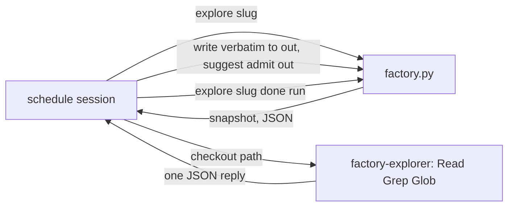
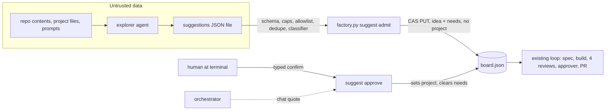
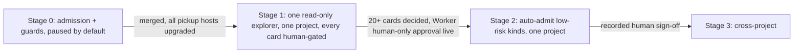
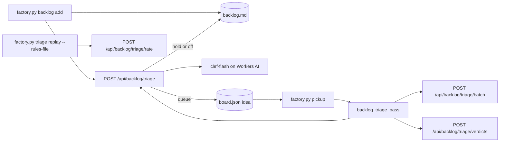
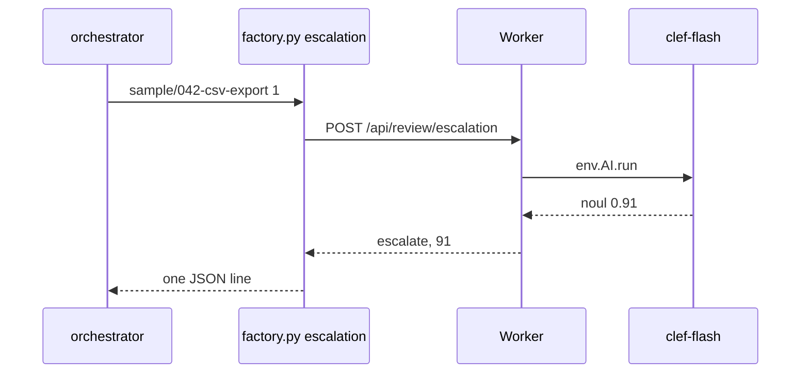

# Autonomy

Explorer agents may one day read a project and suggest work. This page covers the
controls that keep them to *proposing* idea cards. Only a human at a terminal turns
a suggestion into work. Stage 1 adds one read-only explorer for one allowlisted
project, run by a schedule a human enables. The kill switch defaults to paused.

## Commands

All of these run through `factory.py` on a device.

| Command | Who | What it does |
| --- | --- | --- |
| `autonomy status` | anyone | Prints the board's `autonomy` record with defaults filled. Writes nothing. |
| `autonomy report [<slug>]` | anyone | Prints earned-autonomy recommendations. Writes nothing. |
| `autonomy pause` | anyone | Sets `paused: true`. The next `suggest admit` exits 3. |
| `autonomy resume` | human at a terminal | Sets `paused: false` after you type `resume`. |
| `autonomy allow <slug>` | human at a terminal | Adds a registered project to the allowlist after you type its slug. |
| `autonomy deny <slug>` | anyone | Removes a project from the allowlist. |
| `autonomy restore <slug> <class>` | human at a terminal | Lifts the earned-autonomy hold on that class. Later APPROVE PRs merge on green again. |
| `autonomy promote <slug> <class>` | human at a terminal | Lifts a hold once the class earns it, then starts a 14-day cooldown. |
| `autonomy self <slug>` | anyone | Marks a project as part of the factory itself, so the classifier flags its cards. |
| `suggest admit <file>` | trusted launcher | Checks a `factory.suggestions/1` file and adds one gated idea card per new suggestion. |
| `suggest approve <job-id> <A\|B\|C>` | human at a terminal, or an orchestrator relaying the person's chat message (`--chat-file`) | Approves one option after you type the job id, or records the chat quote with `--chat-file`, which lets `factory.py pickup` promote the card. |
| `explore <slug>` | explorer schedule | Snapshots an allowlisted project's base for the explorer and prints the run's paths. Exits 3 when paused or not allowlisted. |
| `explore <slug> done <run>` | explorer schedule | Removes that run's snapshot and keeps its suggestions file. |

Loosening (`resume`, `allow`, `approve`) needs an interactive terminal and a typed
confirmation, or for `approve` a relayed chat message (`suggest approve --chat-file`), as
[chat decisions](../skills/factory/references/chat-decisions.md) says. Tightening never does.
A missing `autonomy` record means paused, with an empty allowlist.

## What admission checks

- The file is at most 64 KiB of UTF-8 JSON. It holds 1 to 5 suggestions with a fixed
  schema, no unknown keys, length caps, no links, no code fences and no control
  characters. Any violation exits 2, and nothing is written.
- The project is registered and on the allowlist, and autonomy is not paused (else
  exit 3).
- A suggestion whose fingerprint matches any card ever admitted, closed ones included,
  is skipped. So is one over the cap of 10 cards a day across the factory, or 5 open
  cards per project. Fingerprints survive archiving: when the Worker archives a card
  off the board, its fingerprint stays in the board's `archived.fingerprints`.
- A deterministic classifier records `eligible` and `reasons` (risky kinds, size L,
  no or many paths, sensitive paths such as CI, auth, deploy and lockfiles). In stage 0
  every card waits on a human whatever it says.

Each card lands at `stage: idea` with no `project`, a `needs` ask and an `origin`
record holding its provenance. The needs-you column shows it. The `idea.md` tab
shows the question, the options with pros and cons, the recommendation and how to
answer. To reject a card, discard it in the idea drawer.

## Stage 1 controls

These harden admission so it can take real explorer output.

- **Fail closed.** A malformed `autonomy` record counts as paused with an empty
  allowlist, and `factory.py` warns on stderr. Malformed means not an object, a
  `paused` that is not true or false, a `projects` or `self` that is not a list of
  strings, or more than one allowlisted project. `autonomy pause` rewrites it clean.
- **One project.** The allowlist holds at most one project. `autonomy allow <slug>`
  exits 2 before any prompt while another project is on it, and names that project.
  Run `autonomy deny <current>` first.
- **Untrusted text.** Every explorer string passes admission rules 3 to 7 from
  [trust.md](trust.md) through `check_untrusted`, so invisible characters, the
  envelope tag, links, secret shapes and override phrases exit 2 with nothing written.
- **Device secrets.** A file holding any `.env` value of 12 or more characters exits
  2 with nothing admitted. The error names the key, never the value.
- **Quoted prose.** The card renders the summary, question and recommendation reason
  as blockquotes. A heading or list inside them stays quoted, so explorer text cannot
  pose as the card's own instructions. A summary is one paragraph: a blank line exits
  2, since blank quote lines collapse.
- **ASCII word rules.** The secret and phrase patterns match ASCII word boundaries
  only, as the Worker's do, so `öignore the previous instructions` still trips them.

## Stage 1 explorer

`schedules/explore.md` runs one explorer over the allowlisted project. A human
materializes and enables it; nothing enables it by default.



- **Snapshot.** `explore <slug>` checks the kill switch and allowlist first, then
  fetches `origin/<base>` and unpacks that commit with `git archive` into
  `<home>/explore/<slug>/<run>/`. Only regular files and directories with safe
  relative paths land there. There is no `.git`, so no origin URL, and no symlink or
  hardlink. It prints `project`, `run`, `commit`, `checkout` and `out`.
- **Done.** `explore <slug> done <run>` deletes the snapshot. The `<run>.json` file
  beside it stays as the run's record. A crashed run leaves its snapshot until a
  `done` removes it.
- **Claude only.** The `factory-explorer` role has Read, Grep and Glob only: no
  shell, write or web tool. OpenCode's installed copy carries no tool limit, so the
  schedule stops with `no claude route: runtime <runtime>` unless the picked route's `runtime` is
  `claude`. `runtime` is the provider's base runtime, from the `extends` chain in
  this host's Paseo `config.json`, so a provider named `claude-x` that extends
  `opencode` stops.
- **Human gate.** The schedule never runs `suggest approve` or an `autonomy`
  command. Every admitted card still waits on a human.

The explorer replies with one `factory.suggestions/1` object, or `{"none": true}`.
Admission enforces these field limits:

| Field | Limit |
| --- | --- |
| `schema`, `project`, `run`, `commit` | `factory.suggestions/1`, then the run's values as `explore` printed them |
| `suggestions` | 1 to 5 objects |
| `kind` | `bug-fix`, `test-gap`, `docs`, `cleanup`, `dependency-upgrade`, `migration`, `security`, `product-idea` or `tooling` |
| `title` | 1 to 80 characters, one line |
| `summary` | 1 to 600 characters, one paragraph |
| `evidence` | 1 to 5 of `path`, `note` (1 to 200 characters, one line) and an optional `line` of at least 1 |
| `paths` | 0 to 20 relative repo paths of `[A-Za-z0-9_./-]`, at most 200 characters, no `..` |
| `size` | `S`, `M` or `L` |
| `question` | 1 to 300 characters, one line |
| `options` | 2 or 3 keyed `A`, `B`, `C`; `label` 1 to 80 and `detail` 1 to 300 characters; 0 to 4 `pros` and `cons` of 1 to 120 characters |
| `recommend` | one of the option keys |
| `reason` | 1 to 300 characters |
| `diagram` | optional, 1 to 1500 characters |

## Trust boundary



- `factory.py`, the Worker and the human are trusted. Everything an explorer reads
  or writes is untrusted data.
- Admission sends only GET and PUT to `/api/board` and GET to `/projects.json`. It
  never runs git, gh or any other process.
- Guards: `ideas` skips any job with a `needs` ask or an unapproved explorer card.
  `board` refuses a patch that sets `origin`, and refuses moving an unapproved
  explorer card to any stage but `idea` or `closed`.
- `origin.approved` carries `decider: "person"`. An older approval without it was made
  by a person, since `suggest approve` is its only writer.
- Honest limit: the Worker cannot yet tell a human from a service token, so a token
  holder could forge an approval with a raw PUT. The runtime guards stop automation,
  except an agent that runs `--chat-file`, which only the chat-decisions
  rule holds back. They do not stop abuse. A Worker-side human-only approval gate must land before stage 2.
- Upgrade every host that runs `factory.py pickup` before the first `autonomy resume`.
  Older runtimes skip cards without a `project`, so unapproved cards stay put there too.

## Retro cards

`retro admit` adds each retro card to the backlog as one held line, not as an idea
card. The line is `- [ ] <project>: <title>`, and its indented context renders on the
dashboard Backlog decision page as a one-pick form. A person answers it there with
Approve or Deny.

```
- [ ] other: Guard the ls alias
  Recommend: approve

  The ls alias crashes without a terminal.

  Why Interactive only: It keeps colors for people.

  Evidence:
  - 253x winsize_crash in tool results (1 session)

  Retro: run 20261111T090000Z-a1b2c3, fingerprint bac6f4150d124158, created 2026-11-12T05:40:00Z

  ## Question: Guard the ls alias
  How should the alias be guarded?
  Pick: one
  - Interactive only (recommended): Alias ls only in interactive shells. Pros: Keeps colors.
  - Drop the alias: Remove the ls alias. Pros: Simplest fix. Cons: Loses colors.
```

- **Per-card project.** Each card carries its own registered `project`. An
  unregistered one exits 2 with nothing added. The line, fingerprint and open cap use
  that project. The one-project allowlist does not apply.
- **Gates.** A paused kill switch exits 3 with nothing added. A card is skipped as
  `duplicate <id>` when a board origin or the archive holds its fingerprint, and as
  `duplicate in backlog` when a `Retro:` line under any backlog line, checked or not,
  does. The daily cap counts board origins and `Retro:` lines created in the last 24
  hours plus this run's adds. The open cap counts the project's idea origins, its
  unchecked `Retro:` lines and this run's adds. Other skips are
  `title ends in a backlog ref`, `context: <why>` and `already in backlog`. It prints
  `{"admitted": [...], "skipped": [...]}` and exits 3 when nothing was added.
- **Never triaged.** `backlog add` and the pickup triage sweep skip any line whose
  context has a `Retro:` line, so the Worker never queues one. An older runtime's
  sweep still rates them, so upgrade every pickup host before the first `retro admit`.
- **Checks.** The field limits, the untrusted-text checks and the `.env` value check
  apply as they do to explorer files. The summary and reason are collapsed to one line.
- **Evidence.** Each evidence item is `{"note", "count", "sessions"}` with 1 to 5
  `host/session` refs.
- **Kind.** `tooling` joins the suggestion kinds.

Retro idea cards admitted before this change keep `origin.by: "retro"` and still
take `suggest approve`, which skips the allowlist for them but needs a registered
project and a human typing at a terminal, or a relayed chat message.

## Lesson cards

`factory.py backlog lesson <slug>/<job-id> --fact-file <file> --why-file <file>`
queues a lesson an agent will not save alone as one held backlog line. The fact is 1
to 200 characters and the why 1 to 300. Both pass the untrusted-text checks and the
`.env` value check, or the command exits 2 with nothing queued.

```
- [ ] factory: Lesson: Worker route changes run pnpm test:protocol; pnpm test skips them.
  Recommend: approve

  Approve adds this bullet to factory/notes.md. No job starts.
  Why it waits: The close reason names the command but not which routes need it.

  Lesson: from 1712-export-csv, queued 2026-11-22
```

Nothing automatic starts a card. Each path checks the `Lesson: from` line in the
line's context.

| Path | Lesson card |
| --- | --- |
| `backlog add` triage | skipped, prints held |
| `backlog_triage_pass` | skipped |
| `next` (`first_item`) | skipped: `a lesson card waits for a person` |
| `batch` (`backlog_candidates`) | left out |
| `backlog decide` approve or rework | exit 2; deny works |

Approve on the dashboard's Backlog decision page calls `POST /api/backlog/lesson`,
which only a signed-in person reaches. The Worker builds the bullet from the stored
`backlog.md`, never from the request, and appends
`- <fact> (<job-id>, <date>)` to `<slug>/notes.md` as the next version, saved by that
person with the summary `Notes: lesson from <job-id>`. A bullet already present answers
`added: false` with no new version, so a retry is safe. The line is then checked off
against a closed job whose note is `lesson added to <slug>/notes.md version <n>`. No
idea job is made, and the page offers no Rework. Deny keeps the closed denied job.
Settings history and Restore to draft undo a bullet. Upgrade every pickup host before
the first `backlog lesson`, since an older runtime's `next` would take a card as an
idea job.

## Agent lessons

`factory.py lesson <slug>/<job-id> --fact-file <file> [--why-file <file>]` lets the
orchestrator save what a close or deny taught. Without a why it appends
`- <fact> (<job-id>, <date>)` to `<slug>/notes.md` through `PUT /api/project-retro`, so it
counts toward the 2 retro edits per file per day.

| Case | Result |
| --- | --- |
| 200 | `added lesson to factory/notes.md version 8: <bullet>` |
| any other status | `not appended: 429 retro edit cap: 2 per file per day`, then a card |
| `notes.md` missing or empty | a card, no PUT |
| `--why-file` given | a card, no PUT |
| bullet fact already a line | `already in factory/notes.md: <fact>`, nothing written |

## Retro pipeline edits

A retro reply may carry up to 2 `edits`, each `{"scope", "stage", "note", "summary"}`.
`retro aggregate` records each scope's `version` and `stage_notes` under `pipeline`.
`retro admit` checks each edit, then sends it to `PUT /api/pipeline/retro/<scope>` as
`{"schema": "factory.retro-edit/1", "run", "base_version", "stage", "note", "summary"}`.
The Worker replaces only `stage_notes[stage]` and saves the next version with
`saved_by: "retro"`, `summary`, `run` and `host`.
Retro edits never change the Babysit note.

| Gate | Refusal |
| --- | --- |
| a paired or active host's bound service token | 403 `retro edits come only from a bound host` |
| a `projects/<slug>` scope whose slug is on the autonomy allowlist; `global` never | 403 `retro edits only allowlisted project scopes; global is person-only` |
| autonomy `paused` is `false`; a missing or malformed record counts as paused | 409 `autonomy is paused; no retro edit` |
| `base_version` is the stored version | 412 `precondition failed` |
| at most 600 characters changed, counted after trimming the shared prefix and suffix | 413 `retro edit changes more than 600 characters` |
| at most 2 retro versions per scope in 24 hours | 429 `retro edit cap: 2 per scope per day` |
| note and summary pass the stage-note checks; the summary is one line of 1 to 120 characters | 400 `<field>: <reason>` |

- **Device first.** Before any PUT, `retro admit` repeats the text checks, the `.env`
  value check, the scope rule, the 600-character cap, the daily cap and the pause. While paused it prints
  `autonomy is paused; no pipeline edit` and sends nothing.
- **Output.** Each edit prints `edited <scope> stage_notes.<stage> to version N: <summary>`
  or `skipped edits[i]...`, and `findings.md` lists it under Pipeline edits. Edits never
  change the exit code. An older Worker answers 404.
- **Kill switch.** `factory.py autonomy pause` stops every retro edit, on the device and
  in the Worker.
- **Restore.** Settings, Pipeline lists each retro version as
  `Version 8 · retro · <time> · <summary> · run <run>`. Click Restore to draft on the
  version before it, type a Change summary such as `Undo retro run a1b2c3`, and Save.
  That writes a new version; history keeps every one.

## Retro edit trials

Each stage-note edit `retro admit` saves runs as a trial over the next jobs. After the
PUT it appends one record to the board's `trials` list and prints
`trial <id> opened: alternate jobs keep the old note until trial settle decides`.
Only `retro admit`, `trial settle` and `trial resume` write `trials`.

| Field | Example |
| --- | --- |
| `id` | `factory-spec-v8` |
| `project`, `stage`, `version` | `factory`, `spec`, `8` |
| `run`, `summary` | the retro run and the edit summary |
| `champion_version` | the pipeline version the edit replaced, `7` |
| `champion`, `challenger` | the note before (`""` when none, display only) and the saved note |
| `opened`, `status` | when the trial opened, then `open`, `kept`, `reverted`, `superseded`, `inconclusive` or `revert-failed` |
| `settled`, `arms`, `reads` | set by `trial settle`: when it decided, each arm's job ids, and the rounds and tokens reads |
| `revert_version`, `resumed` | the version a revert saved, and when a person ran `trial resume` |

- **Arms.** A job is in a trial when its project matches and its `started` is at or after
  `opened`. `trial_arm` hashes `<id>/<job-id>` into arm `a` or `b`, half each. While the
  trial is open, `prompt` gives an arm `a` job in the trial's stage the champion note.
  Arm `b` reads the challenger. When the stored note is no longer the challenger, nothing
  is swapped.
- **Champion source.** The Worker does not validate board `trials`, so the champion note
  that `prompt` and a revert use is read from pipeline history at `champion_version`, never
  from the record's `champion` text. A record is ignored unless its `project` is a slug, its
  `stage` is a pipeline stage, its versions are integers and its `id` is
  `<project>-<stage>-v<version>`.
- **Admit.** `retro admit` skips a stage-note edit while its stage has an open trial
  (`skipped edits[i]: a trial is open for <scope> stage_notes.<stage>`) or while the
  project is paused. Both checks run before the daily cap.
- **Settle.** `factory.py trial settle` runs first in each retro. It stops with
  `autonomy is paused; no trial settled` (exit 3) while autonomy is paused. For each open trial:

| Outcome | When | Prints |
| --- | --- | --- |
| superseded | the stored note differs from `challenger` | `trial <id> superseded: the <stage> note changed after the edit` |
| reverted | `compare()` reads `b higher` on rounds or tokens; the champion is PUT back with summary `Revert trial <id>` | `trial <id> reverted to version <N>: rounds <reads>, tokens <reads>` |
| kept | `compare()` compared the arms with no `b higher` read | `trial <id> kept: rounds <reads>, tokens <reads>` |
| inconclusive | still not compared 28 days after `opened`; the edit stays | `trial <id> inconclusive after 28 days: kept the edit` |
| revert-failed | the revert is refused 28 days after `opened`; the edit stays | `trial <id> revert failed after 28 days: kept the edit: <status> <text>` |
| open | not compared yet | `trial <id> open: a <n> finished, b <n> finished` |

A refused revert prints `trial <id> revert failed: <status> <text>` and leaves the trial
open for the next settle until it is 28 days old. A `revert-failed` trial neither blocks
admit nor counts toward the pause. A revert counts toward the daily retro cap. The board keeps
open records and the newest 20 settled ones. Settle skips malformed records, including
one whose `opened` is not a board timestamp, and drops non-dict entries from `trials`
when it writes the board.
- **Pause.** Two reverted trials without `resumed` pause a project's stage-note edits.
  Settle then prints
  `stage-note trials paused for <slug> after 2 reverts; a person runs trial resume <slug>`,
  and admit skips with
  `skipped edits[i]: stage-note trials are paused after 2 reverts; a person runs trial resume <slug>`.
  `factory.py trial resume <slug>` needs a human at a terminal typing the slug. It sets
  `resumed` on that project's reverts and prints `stage-note trials resumed for <slug>`.
  Settings, Pipeline lists each trial and shows a banner with the trial resume command while a project is paused.
- **Scope.** Retro file edits are not trialled. A host on an older bundle ignores
  `trials`, so its jobs read the current note.

## Retro file edits

A retro reply may also carry file edits, each `{"file", "find", "replace", "summary"}`.
`retro aggregate` records each allowlisted project's `project.md`, `notes.md`,
`decisions.md` and `runbook.md` under `documents`, with the current version and text.
`retro admit` checks each edit, then sends it to `PUT /api/project-retro/<slug>/<name>`
as `{"schema": "factory.retro-doc-edit/1", "run", "base_version", "find", "replace",
"summary"}`. The Worker splices `find` at its one match in the stored text and saves
the next version with `saved_by: "retro"`, `summary`, `run` and `host`. Retro never
creates a missing file and never touches `global`.

| Gate | Refusal |
| --- | --- |
| a paired or active host's bound service token | 403 `retro edits come only from a bound host` |
| the project is on the autonomy allowlist | 403 `retro edits only allowlisted projects` |
| autonomy `paused` is `false`; a missing or malformed record counts as paused | 409 `autonomy is paused; no retro edit` |
| the body shape and schema | 400 `<field>: <reason>` |
| `base_version` is the stored version | 412 `precondition failed` |
| `find` occurs exactly once in the stored text | 409 `find: must match the stored text exactly once` |
| at most 600 characters changed, counted after trimming the shared prefix and suffix | 413 `retro edit changes more than 600 characters` |
| `project.md` frontmatter is unchanged | 403 `retro edits never change project frontmatter` |
| at most 2 retro versions per file in 24 hours | 429 `retro edit cap: 2 per file per day` |
| the saved text and summary pass the project document checks | 400 `<field>: <reason>` |
| `replace` sent to `notes.md` passes the note checks, so no link or override phrase | 400 `replace: <reason>` |

- **Device first.** Before any PUT, `retro admit` repeats the text checks, the
  exactly-once match, the 600-character cap, the file rule, the daily cap and the pause.
- **Output.** A saved edit prints `edited <slug>/<name> to version N: <summary>`, and
  `findings.md` lists it under Pipeline edits. Edits never change the exit code. An
  older Worker answers 404.
- **Restore.** Settings, Projects lists each retro version the same way as Pipeline;
  a person undoes a file edit with Restore to draft on the version before it, then Save.

## Stages



| Stage | Entry | Exit |
| --- | --- | --- |
| 0 | coordinator gate on the spec | merged after 4 reviews and the approver; `autonomy status` on production shows `paused: true`; every host running `factory.py pickup` upgraded |
| 1 | stage 0 exit; a human runs `autonomy allow <one slug>` and `resume` | at least 20 explorer cards decided by a human; zero cards promoted without approve; approve and discard counts by `origin.eligible` recorded |
| 2 | stage 1 exit; Worker human-only approval gate merged; eligible-card approval rate at least 80 percent over at least 20 eligible cards | two weeks with zero reverted auto-card PRs |
| 3 | stage 2 exit; a signed-off decision recorded by a terminal-gated command in the board and in the factory project's `decisions.md` | ongoing |

Each later stage is its own gated job.

## Waiting on other jobs

| Wait | How it is set | What holds |
| --- | --- | --- |
| `depends-on` ref | approving a backlog line, `next`, `batch`, or a board patch | pickup, `ideas` and `batch` skip the idea until the named job is merged, closed or off the board. The card shows "depends on <id>". |
| `not_before` | a board patch such as `{"not_before": "2026-11-17T09:00:00Z"}`, cleared with `null` | pickup, `ideas` and `stuck` skip the job until that UTC time. It does not count toward `max_inflight`. The card shows "Not before <time>". |
| `launch_failure` | `factory.py pickup`, after a launch fails for a reason other than a usage limit | pickup sets `not_before` 5 minutes out, doubling with each failure in a row up to 4 hours, and records `count`, `reason` and `at`. The next successful launch removes the record. The fifth failure in a row moves the job to `needs-human` with a `needs` ask instead and keeps the record. `board` refuses the field. |
| `Depends on: <slug>: <feature>` backlog line | context under a backlog line | Approve is refused while that prerequisite line is unchecked. The dashboard shows "Waits on" and Open the prerequisite. Approve turns the line into a `depends-on` ref. |
| Spec sub-jobs | a spec's Sub-jobs list with `Depends on: <n>` bullets | after merge, each sub-job is queued as a backlog line ending `(sub-job-of <id>)`, with `Depends on:` lines for its prerequisites, so approval follows list order. |

See [board.md](../skills/factory/references/board.md) for the fields.

## Backlog triage

Backlog triage lets a project skip the dashboard Approve click for backlog lines its
rules clearly allow. It is off unless a person turns it on.



Settings, Pipeline holds a `triage` block per scope. A project value replaces the global
one whole. With neither set, triage is off.

| Field | Rule |
| --- | --- |
| `enabled` | true or false |
| `threshold` | an integer from 1 to 100. The dashboard fills in 90 |
| `rules` | text, may be empty. It passes the same admission rules as stage notes, so no links, secrets or instructions to skip review |

After `factory.py backlog add` appends a line, it posts the line and its `--context`
text to the Worker. The Worker reads the effective `triage` block and answers:

| Case | Model called | Decision |
| --- | --- | --- |
| triage off or not set | no | `off` |
| context line 1 is `Recommend: deny` (LF or CRLF) | no | `hold` |
| context has a `## Question:` line | yes | `hold`, with `choices` |
| confidence at or above the threshold | yes | `queue` |
| confidence below the threshold | yes | `hold` |

- **Queue.** `factory.py` adds an `idea` row with `backlog.by: "triage"` and the verdict,
  then checks the line off with the new id, as a dashboard Approve does. If the line
  changed meanwhile, it drops the row while the row is still an unclaimed idea. The idea
  carries the line's context under `Context from the backlog:`, cut so the idea stays within
  4000 characters, as a dashboard Approve does.
- **Decider.** Every verdict carries `decider`. The deny and question holds are `rule`,
  even when a question hold has a score, and a threshold verdict is `model`. Board `backlog` records
  carry `decider` too: `person` from the dashboard or `backlog decide`, `model` when triage queued
  the line. Older records infer it: `by: "triage"` means `model` and any other is `person`. An
  older hold with no confidence, or with a deny or question reason, is `rule`.
- **Hold.** The line waits in the backlog for a person, as before.
  The Worker keeps the latest hold verdict for each line, keyed by `<slug>: <feature>` without trailing whitespace, and the backlog drawer shows it under Held by triage. The board reads the stored verdicts of the lines it lists in one `POST /api/backlog/triage/verdicts` call per 50 lines. It reads again only when the listed lines change, and only for lines with no verdict yet. Opening a line with no verdict reads that line again. A line the Worker would refuse, such as one over 2000 characters, reads as no verdict and leaves the other lines' verdicts intact.
- **Sweep.** Lines that `backlog rework` appends, or that a person types, get the same
  verdict from `backlog_triage_pass`. `factory.py pickup` runs it before it claims ideas, never with `--dry-run`, and at most once every 30 minutes per host. The host's `backlog-triage-sweep.json` holds the start of the last sweep, and `factory.py pickup --triage-now` runs a sweep at once. Each sweep takes up to 20 unchecked lines in projects whose effective `triage.enabled` is true and reads their stored verdicts in one `POST /api/backlog/triage/verdicts`. A line another host already held is recorded without a post. The rest go with the indented block under each as context. Plain lines go up to 8 per `POST /api/backlog/triage/batch` call, one project per call, in file order. In a live run, one batch of 8 plain lines sent 1724 input tokens against 2329 for 8 single calls, a saving of 26%. Lines whose context has a `## Question:` line then post alone to `POST /api/backlog/triage`. An older Worker answers the batch route with 404, and a batch it refuses whole gets a 400, so those lines post one at a time. In a batch reply, an entry the model answered unusably (502) warns and waits for the next sweep without ending it, and an entry refused with a 400 is recorded like a single 400. Held lines, and lines the Worker refuses with a 400, go into the host's `backlog-triage.json`, so this host never sends them again. `backlog add` records its held line there too. A 404, 409, 502 or 503 reply, or a network failure, warns and ends the sweep. That line and the rest are retried on the next sweep. Deleting the file
  only causes rescoring. A line whose new idea row could not be checked off or removed goes
  there too, so it is never queued twice.
- **Failure.** A 404 from an older Worker means off. Any other error prints a warning,
  and the line waits. If a board or backlog write fails while
  queueing, it prints what is left (the line, or the new id to check off or remove by hand).
  `backlog add` still exits 0. A Worker error inside the sweep, such as a 500 on GET /api/backlog,
  prints the error and "backlog triage stopped; unsent lines wait for the next sweep, or run pickup --triage-now". The sweep
  keeps the holds it recorded, and pickup still claims and launches ideas. While the sweep keeps
  failing, pickup's host status carries `triage_failed_since`, the start of the first failing run.
  Settings, Hosts shows "Backlog triage failing since <time>" in red with a warning sign on the
  host's card until a sweep succeeds.
- **Person only.** Pipeline documents are saved only by a signed-in person (F11), so a
  service token cannot switch triage on or move the threshold. The one exception, retro
  admit, may edit only stage notes. The Worker compares the
  score with the threshold itself.
- **Prompt.** The Worker sends `@cf/cloudflare/clef-flash` a `state` text and one `build`
  question of type `noul`. In `state` the rules travel in an `operator-preferences` envelope and
  the item in a `backlog-item` envelope, both marked as data. The question asks whether the item
  should be built now without a person reviewing it, and its yes probability times 100, rounded,
  is the confidence. A batch call puts each item in its own `backlog-item id="<n>"` envelope,
  where `<n>` is the item's position in the request, and asks one `build.<n>` question per item
  that judges only item `<n>`, under the same rules envelope. The verdict's `reason` is fixed
  text: `Rated by clef-flash against the project rules.`, or `Rated by clef-flash.` when the rules
  are empty, so an item can move the score but write no text. An item or context holding either
  tag, including fullwidth, Cyrillic, Greek or other lookalike forms, or a letter that reads as
  either l or I, is refused with a 400.
  For an item whose context has `## Question:` sections, the same call adds one `choice`
  question `q<i>` per backlog question, over its options, and one `choice` question
  `q<i>.o<k>` per option, over fixed reasons such as `It gives the item the most value.`
  (`It follows the project rules.` only when rules are set). The hold verdict then carries
  `choices`: for each question its header, the model's pick and its percent, and each option's
  percent and reason. The drawer shows them under Held by triage. If the questions do not parse,
  the binding is missing, or the call fails or gives an unusable reply, the item gets the fixed
  hold with no `choices`.
- **Duplicate check.** After a `queue` decision, the Worker makes one more clef-flash call per
  single line or batch, covering only the queued items. Its candidates are the open jobs of the
  same project on `board.json`: not `merged` or `closed`, newest `updated` first, at most 20,
  titles cut to 80 characters. It asks one `dup.<n>` `choice` question per queued item over
  `none` and `j1` to `j20`, and the Worker maps the pick back to an id from its own list. The
  verdict then carries `duplicate`, which `factory.py` stores as `backlog.triage.duplicate` and
  prints as `; possible duplicate of <id>`. While the job is an idea, its card shows
  `possible duplicate of <id>`. The note is advisory: it never holds, closes or changes the
  queue decision, and no candidates, a missing binding, a failed call or a pick of `none` just
  leave it out. Holds and question items get no check.
- **Replay.** `factory.py triage replay <slug> [--threshold N] [--rules-file PATH]` scores a
  threshold against what people decided. Its labels are the project's board and archive `backlog` records whose decider
  is `person` and decision is `approved` or `denied`, latest `at` per line. Each label is paired with
  the line's stored model hold: a confidence at or above the threshold queues. `agreement` is
  `round(100 * (queue_approved + hold_denied) / scored)`, or null with nothing scored. Rule holds and
  lines with no stored hold count under `unscored`. `model_queued` counts lines triage queued, which
  no person decided, so a higher threshold stays untested. It prints JSON with a row for the current
  threshold and one for `--threshold` when it differs. Without `--rules-file` it is read only: no
  model calls and no writes. With `--rules-file PATH` it reads the file as UTF-8 first, then posts
  the scored lines 8 at a time to `POST /api/backlog/triage/rate`, which rates each bare line under
  those rules through clef-flash and stores nothing. The new confidences replace the stored ones,
  and a line the model gave no usable answer for counts under `unscored.rating_failed`. The JSON
  adds `rules_file`. Bare lines carry no context, unlike the stored ratings, so compare one rules
  file against another, not against the threshold-only table. An older Worker answers 404, and
  replay exits 5 and says to deploy the current Worker.
- **Floors.** A queued idea still goes through the spec, the reviews F2 requires, the
  approver, merge rules and any `spec-approval` gate.
- **Deploy.** The Worker needs the `ai` binding, which `tools/deploy.py render` adds.
  Workers AI usage bills against the account. Without the binding the route answers 503,
  and lines wait. In a 36-call live run, a call sent a median of 292 input tokens, which costs about
  $0.000011, or about 1 neuron. The free tier of 10,000 neurons a day covers about 9,900
  calls. In a live run, a question item with 3 questions of 4 options sent 3075 input
  tokens, about 11 neurons, and a plain item sent 292, about 1 neuron.

To stop triage, set it to Off in Settings, Pipeline. Ideas it already queued stay
ordinary ideas, and a person can discard them.

### Needs questions

When a device pushes a job's `needs.md` with `## Question:` sections, and the project's effective `triage.enabled` is true, the Worker asks clef-flash which option fits each question and why. It stores the pick, each option's chance and one fixed reason in `needs-triage/<slug>/<id>.json`, and the needs form shows them. The reasons are the same fixed sentences backlog triage uses. A missing AI binding, a model failure, an unusable reply or a `needs.md` over 6000 characters stores nothing, and the push still succeeds. The form never fills in an answer.

The push does not wait for the rating: the Worker rates the file after the reply with ctx.waitUntil, so needs-rating;dur=<ms> reads near 0. The `needs.md` PUT reply says how long the push waited in `Server-Timing: needs-rating;dur=<ms>`. The stored record's `ms` field is the model call alone. Read it at `GET /api/jobs/<slug>/<id>/needs-triage.json`. The record carries `decider` `"model"`, as a threshold verdict does.

## Review escalation

After a review round with CHANGES below the round cap, one clef-flash call over the
findings decides whether the job needs a person now. There is no setting: the
threshold is a code constant of 80, a guess that has not been measured.



- `factory.py escalation <slug>/<job-id> <round>` reads `round-<N>/review-*.md` and sends
  only the reviews whose first line is `VERDICT: CHANGES`, each cut to 8000 characters.
- The Worker wraps each review in a `<review-findings reviewer="..." trust="data">`
  envelope and asks one `escalate` question of type `noul`. Confidence 80 or more is
  `escalate`, below is `continue`. The reason is fixed text, so review text can move the
  score but write no words.
- On `escalate`, loop step 5 in references/commands/feature.md pushes the job, patches it to `needs-human` with
  a `needs` link to the first CHANGES review, and dispatches nothing.
- The check runs only below the cap. It never runs after approver CHANGES, at the round
  cap, or on an all-PASS round, and it sees only the current round.

Request: `{"reviews": {"security"?: text, "ux"?: text, "ui"?: text, "code"?: text}}`, at
least one key, body cap `160 << 10` bytes. A review over 8000 characters, an unknown
reviewer or key, or a control or invisible character gets a 400. Variation selectors and
zero-width joiners between emoji are the two exceptions. Before the call, the Worker
removes those, replaces secret-shaped text with `[secret-shaped text removed]`, replaces a
`review-findings` tag with `[review-findings tag removed]` and an `operator-preferences`
tag with `[operator-preferences tag removed]`, and cuts the result to 8000 characters.
When the text holds a tag or a secret shape in fullwidth or look-alike letters, the Worker
folds those letters to ASCII first, and the rest of that review is folded with it, so a
token such as `ｇｈｐ＿…` or `gһp_…` is removed too. A review that quotes a secret or a
tag, or writes an emoji such as ⚠️ or 👩‍💻, is still rated.

Reply 200: `{"decision": "escalate"|"continue", "confidence": int, "threshold": 80,
"reason": text, "model": "@cf/cloudflare/clef-flash", "decider": "model"}`. The reason is
`clef-flash rated the findings as needing a person.` or
`clef-flash rated the findings as fixable by the builder.`

| Case | Output | Loop |
| --- | --- | --- |
| no CHANGES review | `continue`, `decider` `"rule"`, no call | unchanged |
| 400, 404, 502, 503, network, bad reply | warning, `continue`, `decider` `"rule"` | unchanged |

A failed check never blocks a job. It only skips the extra stop. The round cap, the
approver and the merge rules still apply. The Worker must deploy before hosts upgrade, or
`factory.py` sees 404 and continues.

## Repeated findings

Loop step 5 runs `factory.py repeats <slug>/<job-id> <round>` below the round cap and before the escalation check, and loop step 4 reads `repeats` from `factory.py pre-review`. `factory.py repeats` saves each repeat in the board job's `repeated`.

| Case | Result |
| --- | --- |
| Round 1, or no earlier round folder | `continue` |
| CHANGES review with no signature lines | `continue`, round cap still applies |
| A PASS round between the two | `repeat` |
| Disputed-only round, reviewer keeps the finding | `repeat`: a person settles the dispute |
| Same file changed in rounds N-2, N-1 and N | `churn` |
| Missing round head or rewritten history | `continue` |
| Files only a base-branch merge changed | `continue` |
| Corrupt `pre-review-failures.json` | read as `{}` and rewritten |

### Failure classes

| Exit or log | Class | Loop |
| --- | --- | --- |
| `"timeout"` | `budget` | builder |
| `"missing"`, 126, 127 | `structural` | needs-human |
| negative, 130, 143 | `canceled` | needs-human |
| log tail matches `TRANSIENT_LOG` | `transient` | retry once, then builder |
| any other nonzero | `deterministic` | builder, counts toward repeats |

## Diff budget

`factory.py pre-review` compares the size the spec's Tasks `- Files:` lines imply with the branch's diff against `origin/<base>`. It writes a `Budget:` line after `Head:` and a `budget` object in its JSON line. When the branch is over, `pre-review.md` gets a `## Diff budget` section the code reviewer must judge. The budget only warns: it never changes the exit code or the stage.

| Measure | Rule |
| --- | --- |
| Expected files | distinct paths in Tasks `- Files:` lines |
| Expected lines | expected files x `DIFF_BUDGET_LINES_PER_FILE` (150) |
| File limit | expected files x `DIFF_BUDGET_FILE_FACTOR` (2) |
| Line limit | expected lines x `DIFF_BUDGET_LINE_FACTOR` (3) |
| Branch | `git diff --numstat --no-ext-diff --no-textconv` merge-base to HEAD, added plus deleted |

- The result is `over` when files exceed the file limit or lines exceed the line limit, otherwise `within`.
- A token with `*` is an `fnmatch` glob, and a token ending in `/` covers everything under it. Absolute paths and `..` never count.
- Binary files count 0 lines. The section lists up to 20 changed paths no token covers.
- A stacked rider measures from the merge base with its lead's local branch `factory/<lead>`, so the lead's commits do not count. Without that branch the budget is `none`.

| Case | Budget |
| --- | --- |
| No `spec.md` in the job folder | `none (the job folder has no spec.md)` |
| `spec.md` is a link | `none (spec.md is a symlink or junction)` |
| No usable Files path | `none (spec.md has no task Files paths)` |
| `fetch_base` failed | `none (the base could not be fetched)` |
| Git numstat fails | `none (the branch diff could not be read)` |

## Rollback

| Scope | Rollback |
| --- | --- |
| One card | Discard it in the idea drawer. It moves to `closed`, and its fingerprint stays, so it never returns. |
| Admission | `autonomy pause` from any device. The next admit exits 3. |
| Stage 0 code | Pause, discard open explorer cards, revert the PR. No data migration: older code ignores the `autonomy` and `origin` keys. |
| Stage 1 and later | Pause, then `autonomy deny <slug>`, and revert that stage's PR. |

## Earned autonomy report

`factory.py autonomy report [<slug>]` reads the board and prints, for each project and job class, the outcomes `outcomes record` stored on jobs merged in the last 90 days. It recommends `automerge`, `hold` or `collect` and writes nothing. A person changes Merge under Settings, Pipeline.

The class comes from the job's first review round:

| `rounds[0]` | Class |
| --- | --- |
| `ux` and `ui` both `SKIPPED` | `internal` |
| anything else | `visible` |
| `rounds` missing or empty | skipped and listed |

Each cell is measured against these thresholds, which the report prints. Threshold evidence below shows where each comes from:

| Metric | Formula | Threshold | Source |
| --- | --- | --- | --- |
| scanned | held + reworked + reverted | at least 20 | starting guess |
| reverts | count of `reverted` | 0 | starting guess |
| rework | reworked / scanned | at most 10% | starting guess |
| rounds | mean `len(rounds)` | at most 1.75 | tuned 2026-11-22 |
| changes | `CHANGES` / (`PASS` + `CHANGES`) over every round | at most 10% | tuned 2026-11-22 |

- Any revert, or any metric over its threshold, means `hold`.
- Fewer than 20 scanned jobs means `collect`.
- Otherwise the cell gets `automerge`. A project gets `merge auto` only when every one of its cells is `automerge`.

Synthetic project `alpha`, with 20 internal jobs and 6 visible jobs, one of them reverted:

```text
earned autonomy for jobs merged in the last 90 days
thresholds: 20 scanned jobs, no reverts, rework at most 10%, mean rounds at most 1.75, CHANGES at most 10%
project  class     jobs  held  reworked  reverted  unscanned  rounds  changes  recommend
alpha    internal    20    19         1         0          0     1.2       8%  automerge
alpha    visible      6     4         1         1          0     2.0      25%  hold
alpha visible hold: reverted 1019-add-z; rework 17% over 10%; rounds 2.0 over 1.75; changes 25% over 10%
alpha: recommend merge human until every class shows automerge
report only: a person changes Merge under Settings, Pipeline; nothing was written
```

### Threshold evidence

Measured from the live board on 2026-11-22:

| Fact | Value |
| --- | --- |
| Merged jobs in 90 days | 1,894, oldest merged 2026-10-23 |
| With review rounds | 1,273 in 14 cells |
| Recorded `outcome` | 0 |
| `rework-of` refs | 16 |

| Cell (20 or more jobs) | Jobs | Rounds | CHANGES |
| --- | --- | --- | --- |
| `factory` visible | 766 | 1.49 | 4.6% |
| `factory` internal | 55 | 1.36 | 2.5% |
| project B visible | 169 | 1.34 | 6.3% |
| project C visible | 156 | 1.35 | 6.2% |
| project D visible | 62 | 1.37 | 5.1% |
| project E visible | 33 | 2.03 | 13.4% |

- For each metric, sort the cell values, take the largest gap between neighbors, and set the limit at its midpoint. Round rounds to 0.05 and CHANGES to 1 point.
- Rounds: the largest gap runs from 1.49 to 2.03, midpoint 1.76, so the limit is 1.75. CHANGES: from 6.3% to 13.4%, midpoint 9.85%, so 10%.

Kept as guesses: 20 scanned jobs, no reverts and rework at most 10%. The board had no recorded outcomes and only 30 days of merges, so nothing could tune them. Re-tune them once `outcomes record` has filled 90 days.

## Earned autonomy hold

A revert in a project and job class holds that class's APPROVE PRs for a person. Pickup's hold pass covers PRs already waiting at `pr-open`, and `checks` exits 8 before any agent merge. Both write the hold.

A class is held while a board job meets every condition:

| Condition on a board job | Needed |
| --- | --- |
| `stage` | `merged`, `done` within 90 days (same filter as the report) |
| `outcome.result` | `reverted` |
| class | `internal` or `visible`, from `rounds[0]` |
| `outcome.at` | later than `autonomy.restored["<slug>/<class>"]`, or no restore exists |

The hold on synthetic job `1031-add-w`, PR #631, after `1019-add-z` was reverted in `alpha` `visible`:

| Field | Value |
| --- | --- |
| `automerge` | `false` |
| `needs` | `review and merge PR #631: earned autonomy holds alpha visible PRs after reverted 1019-add-z; a person lifts it with factory.py autonomy restore alpha visible` |
| `note` | `earned autonomy hold: a person reviews and merges` |
| pickup prints | `held 1031-add-w alpha PR #631 for a person` |

A person restores the class:

| Step | Result |
| --- | --- |
| `autonomy restore alpha visible` | asks `Type alpha visible to let alpha visible APPROVE PRs merge without a person again: ` |
| types `alpha visible` | `restored["alpha/visible"] = "<UTC time>"` |
| a revert recorded later | holds again |

- Restore needs a terminal, like `autonomy resume`, because it loosens autonomy.
- A malformed `restored` entry is ignored, so the hold stays.
- PRs already held keep their `needs` until a person merges them.

## Earned autonomy promotion

`autonomy promote <slug> <class>` lifts a hold only after the class earns it. `restore` stays the ungated override. The example is synthetic: `1019-add-z` in `alpha` was reverted at `2026-10-23T10:00:00Z`, then 20 `visible` jobs merged, all `held`, and the time is `2026-11-22T10:00:00Z`.

| Gate | Rule | Example |
| --- | --- | --- |
| held | `autonomy_holds(data)` has `("alpha", "visible")` | yes |
| since | latest `outcome.at` (else `done`) of the held reverts | `2026-10-23T10:00:00Z` |
| jobs | `autonomy_cell` of cell jobs with `done` after since gives `automerge` | 20 scanned, passes |
| time at level | whole days since `since` at least 7 | 30 |
| cooldown | now past `promoted["alpha/visible"].until` | no record |
| person | types `alpha visible` at a terminal | yes |

Promote on the example:

| Field | Value |
| --- | --- |
| prompt | `Type alpha visible to promote alpha visible so its APPROVE PRs merge without a person: ` |
| `restored["alpha/visible"]` | `2026-11-22T10:00:00Z` |
| `promoted["alpha/visible"]` | `{"at": "2026-11-22T10:00:00Z", "by": "<device>", "jobs": 20, "days": 30, "until": "2026-12-06T10:00:00Z"}` |
| stderr | `alpha visible promoted. PRs already held keep their needs line until a person merges them.` |

Refusals change nothing:

| Case | Exit | stderr after `factory.py: ` |
| --- | --- | --- |
| 12 scanned | 3 | `alpha visible cannot be promoted yet: needs 8 more scanned jobs; nothing was changed` |
| 3 days at hold | 3 | `alpha visible cannot be promoted yet: 3 days held, needs 7; nothing was changed` |
| not held | 3 | `alpha visible is not held, so there is nothing to promote; nothing was changed` |
| no TTY, typo, bad class | 2 | the usual terminal and usage text |
| unregistered | 4 | `no factory project beta` |

- The gates run before the prompt and again on the fresh board inside the write.
- Promote also stamps `restored`, so the next revert starts a fresh window.
- A malformed `promoted` entry for the class refuses promotion rather than dropping the cooldown.
- The 7-day and 14-day values are starting guesses.
