# Dashboard tour

This page walks through every dashboard view with a made-up job, `051-sample-retry`, "Retry the sample upload", which waits on you with the question "Pick a retry limit".

## Before you start

- You need a deployed instance and an Access login. See [getting-started.md](getting-started.md).
- The example job is made up. Your board shows your own jobs.

## The board

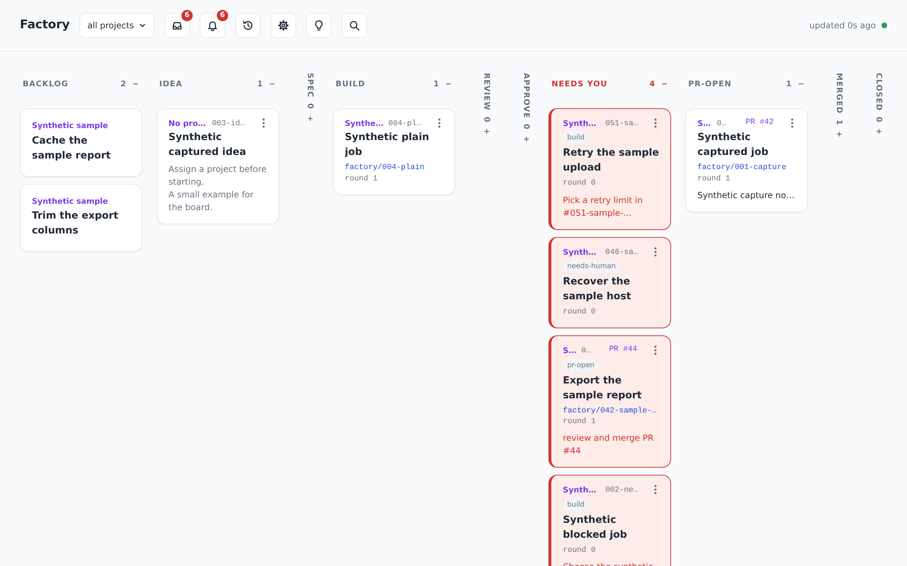

- The columns are `backlog`, `idea`, `spec`, `build`, `review`, `approve`, `needs you`, `pr-open`, `merged` and `closed`.
- Needs you collects every job that waits on you, whatever its stage. `051-sample-retry` sits there.
- Starred jobs carry a "Starred" chip.
- Click a card to open its job panel.

## The job panel

- The tabs are `idea`, `spec`, `build`, `Pre-review`, `R<n> security`, `R<n> ux`, `R<n> ui`, `R<n> code`, `rework <n>`, `decision`, `needs`, `answers`, `scratchpad` and `audit`.
- A page with a walkthrough shows an "Interactive walkthrough" bar with Show and Expand.
- The Star button stars the job. Stars stay in this browser.
- Babysit PR sits in the header and in the Job actions menu. It shows only for a `pr-open` job with a PR that is not paused, closing or a batch rider. It asks you to confirm. Then it sets the note `babysitting PR #<n>`, clears needs and escalation, and prioritizes pickup.
- Open the Job actions menu with `A` or `.`.

## New idea

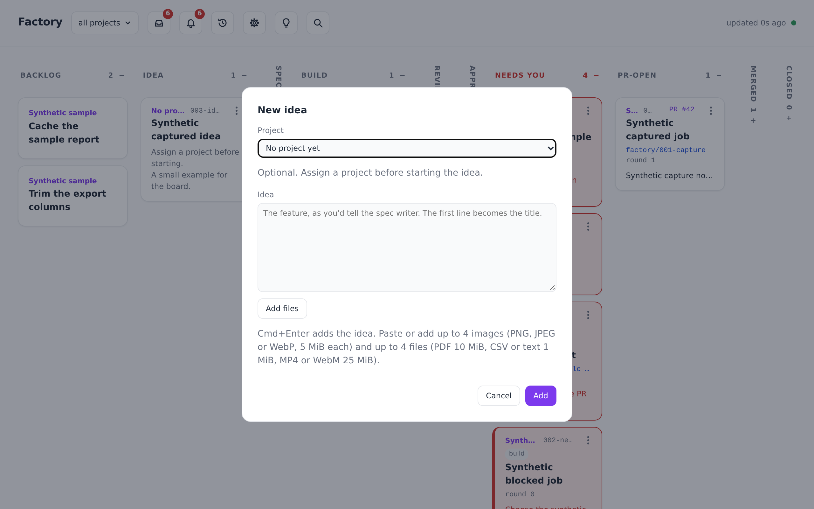

- The first line becomes the title. An idea holds 4000 characters at most.
- On a Mac, Cmd+Enter adds the idea. Other systems use the Add button.
- Attach up to 4 images by paste or Add files. Images can be PNG, JPEG or WebP, 5 MiB each.
- Attach up to 4 files: PDF up to 10 MiB, CSV or text up to 1 MiB, MP4 or WebM up to 25 MiB.

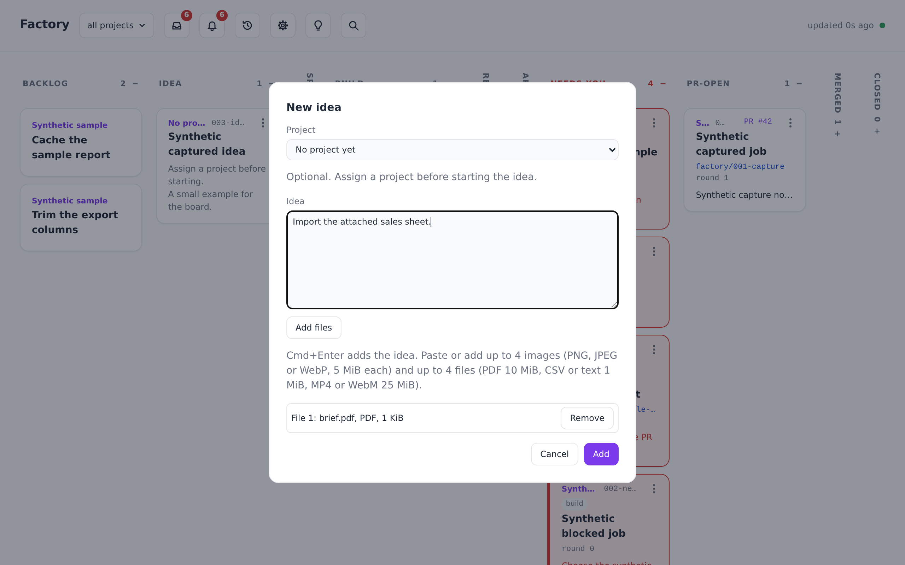

- A thumbnail, a gallery image or an image in a job page opens the image viewer.
- In the viewer, use Previous, Next or the arrow keys. Close it with Close or a click on the backdrop.

## Inbox and the W key

Route `#/inbox`, key `I`.

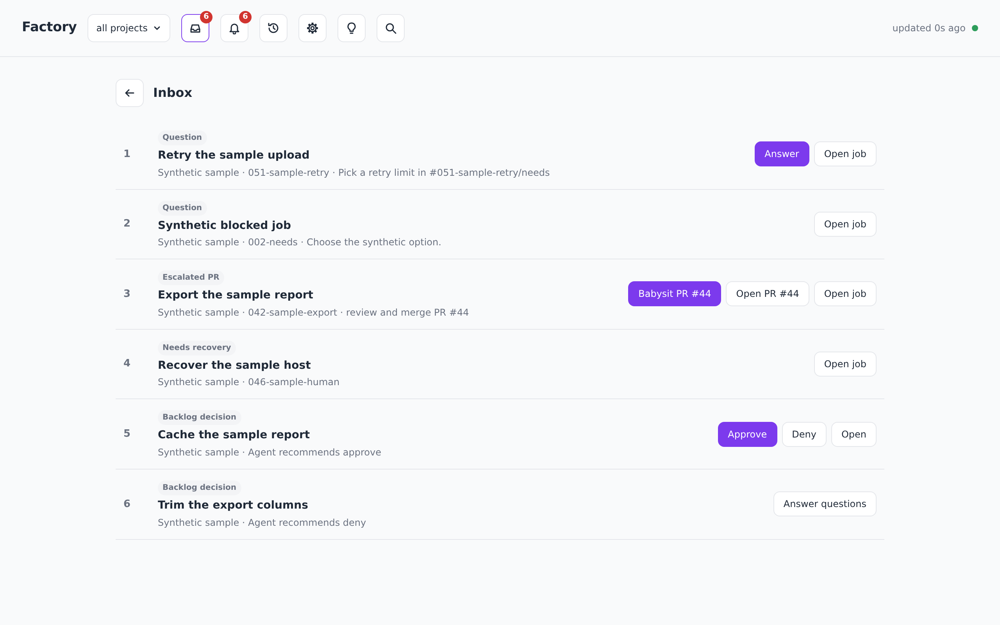

- Rows are ranked Question, Escalated PR, Needs recovery, then Backlog decision.
- Within a rank, prioritized jobs come first, then the oldest.
- `051-sample-retry` shows under Question. You can answer "Pick a retry limit" in its row.
- Left and Right arrows move between rows.
- Escalated PR rows offer "Babysit PR #<n>".
- `W` opens the next job waiting on you, oldest update first. There is no button for it. Use the key.

## Notifications

Route `#/notifications`.

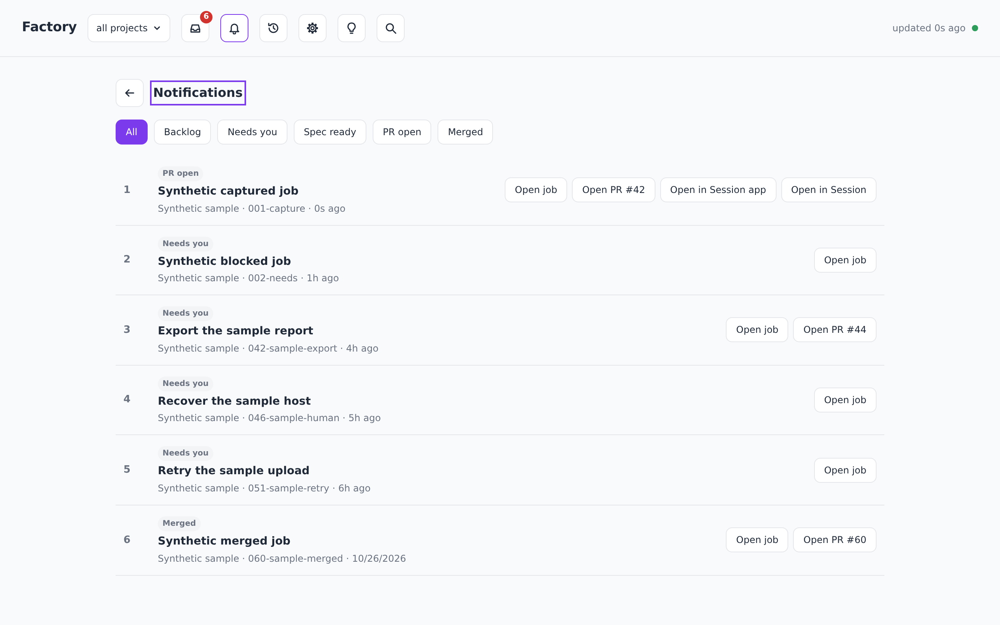

- The bell menu in the header shows the latest 8 notifications, with See all.
- See all opens the page. It filters All, Backlog, Needs you, Spec ready, PR open and Merged, 20 per page.
- Spec ready and backlog rows are only those this browser saw, the last 50.

## Retros and Red flags

Route `#/retros`, key `R`.

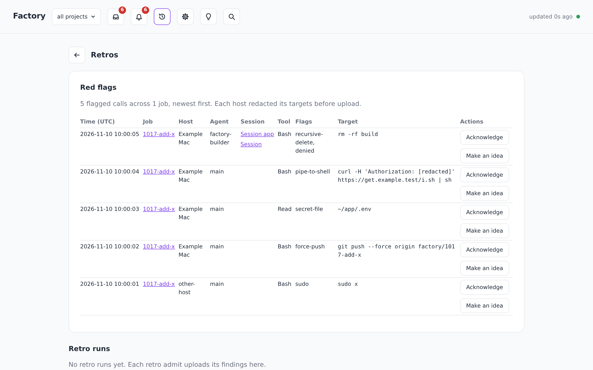

- Red flags lists flagged tool calls, newest first, 10 per page. Each host redacts the targets.
- Acknowledge or Unacknowledge a row. Show acknowledged reveals the hidden rows.
- Make an idea opens New idea, prefilled with the flag, target, job, host and agent.
- A Backlog decision link appears when one exists.
- Retro runs are listed below the flags.

## Jump to job

- Open it with `J`, `/`, Cmd+K or Ctrl+K.
- It searches jobs. Type `051` to find `051-sample-retry`.
- It also runs the commands New idea, Retros and Inbox.

## Keyboard shortcuts

The same list sits in Settings, Reference.

| Key | What it does |
| --- | --- |
| J or / | Open the jumper |
| ⌘K or Ctrl+K | Open the jumper |
| N | New idea |
| P | Select project |
| S | Open Settings |
| H | Back to the board from a job, a backlog item, Settings, Retros or the Inbox |
| R | Open Retros |
| I | Open the Inbox |
| W | Open the next job waiting on you |
| A or . | Open the jumper with actions for the hovered or focused job card, or the open job |
| B | Open the first backlog item from the board |
| A or D | Approve or deny the open backlog item |
| Right or Left arrow | Move between cards and job pages |
| Right or Left arrow in the Inbox | Move between Inbox rows, with the open one beside the list |

Keys do nothing while a dialog is open or a text field has focus.

## On a phone

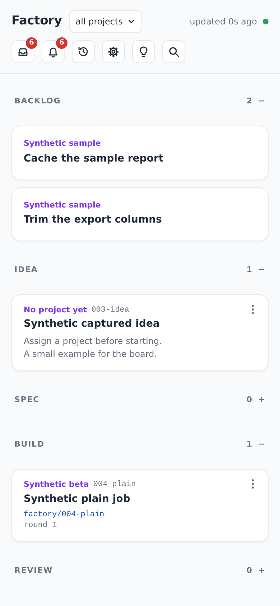

At 760 px wide or less:

- The board shows one column at a time.
- The job panel fills the width. Swipe left or right to move between tabs.
- Settings sections sit in a row that scrolls sideways.
- Touch targets are 44 px.
- Display, Install app adds the dashboard to the home screen where the browser allows.

## Settings

Route `#/settings/projects`, key `S`. Each section has its own route, such as `#/settings/hosts`.

### Projects

Route `#/settings/projects`.

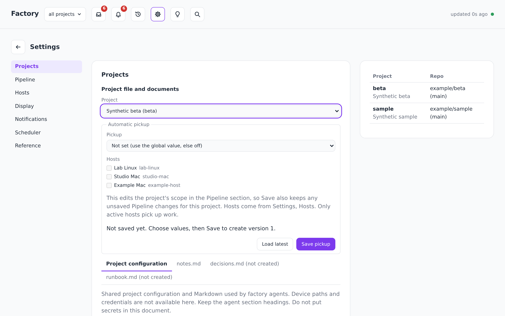

- Edit the shared project file and its `notes.md`, `decisions.md` and `runbook.md`.
- Each file keeps a history. Pickup can be set per project.

### Pipeline

Route `#/settings/pipeline`.

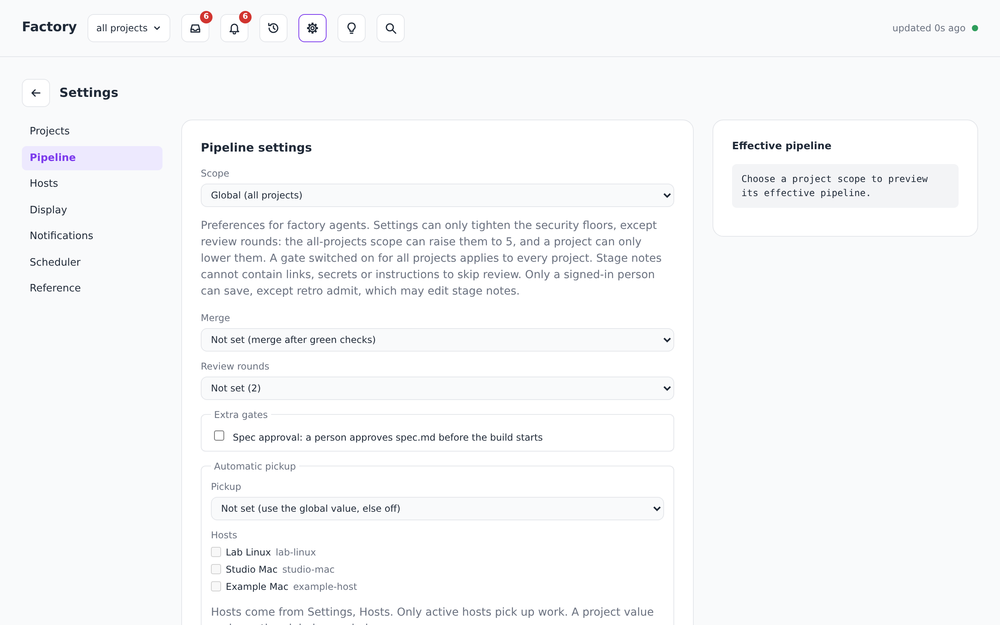

- Scope, Merge, Review rounds and the Spec approval gate.
- Automatic pickup hosts, Backlog triage, Batch follow-ups, Archive old jobs and Tracer.
- Stage notes for Spec, Build, Review, Approve and Babysit.

### Hosts

Route `#/settings/hosts`.

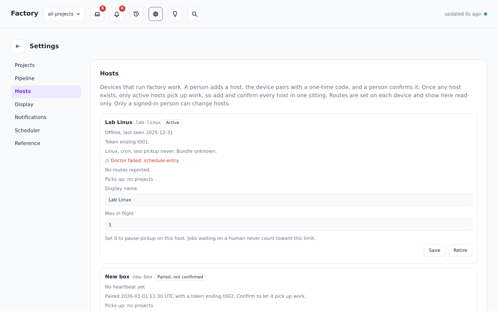

- Add host, pair it with a one-time code, then Confirm.
- Retire a host, or issue a New code.
- Only active hosts pick up work.

### Display

Route `#/settings/display`.

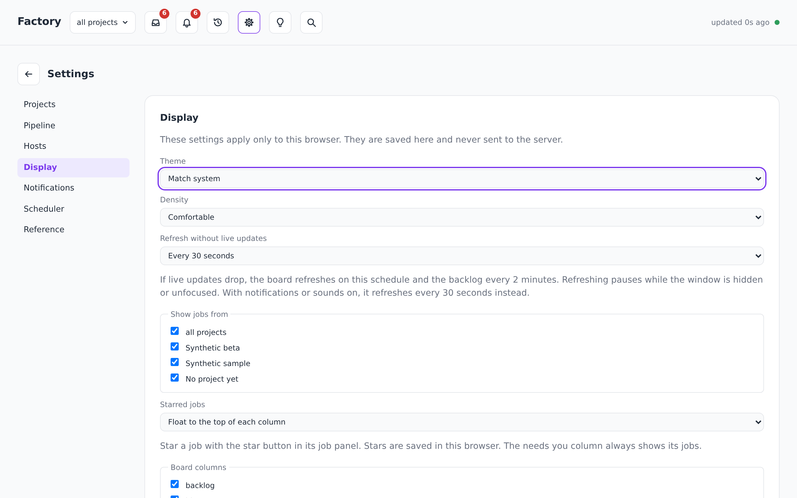

- Theme, Density, Refresh without live updates and Show jobs from.
- Starred jobs: float, only or off.
- Board columns, Card details, Job panel links and New idea project.
- Reset and Install app.
- These settings are saved in this browser only.

### Notifications

Route `#/settings/notifications`.

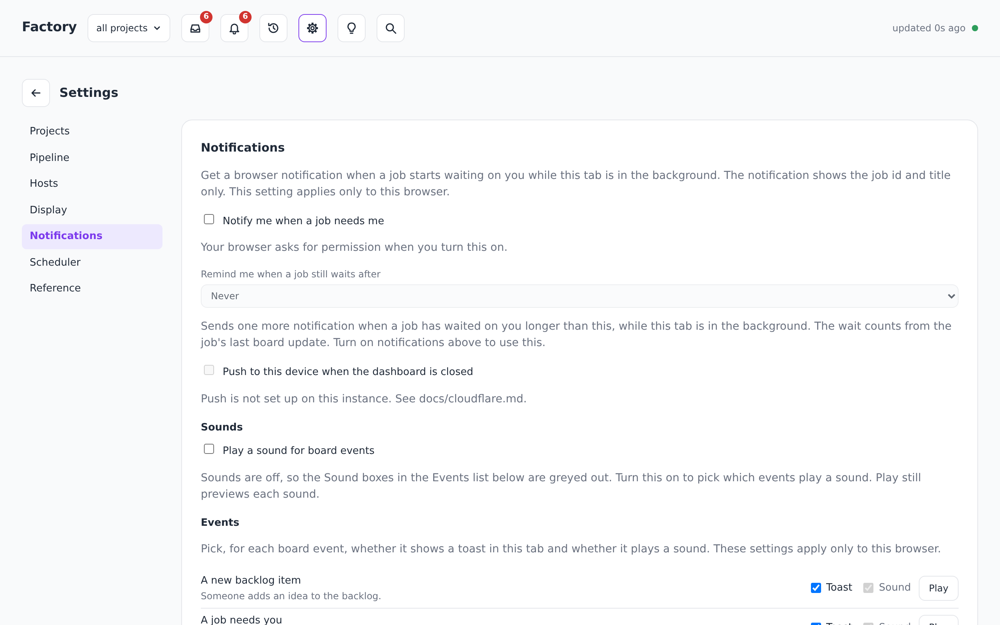

- A browser notification when a job needs you.
- A reminder after 1 hour, 4 hours or 1 day.
- Push when the dashboard is closed. This needs `FACTORY_VAPID_KEY`.
- Sounds, and a list of toasts and sounds per event.

### Scheduler

Route `#/settings/scheduler`.

- Agent or Human setup for the 5-minute `factory.py pickup` timer.
- Snippets for cron, launchd and Task Scheduler.

### Reference

Route `#/settings/reference`.

- Read only.
- Security floors, the gate catalog, the effective pipeline by project, instance links and the keyboard shortcuts.

## Related

- [getting-started.md](getting-started.md): install and first login
- [configuration.md](configuration.md): config layers and browser settings
- [cloudflare.md](cloudflare.md): instance setup and push notifications
