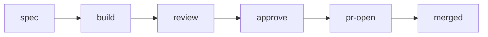

# Getting started

This page takes you from a deployed instance to a first merged job, then lists what to set up next. Prefer an agent to walk you through it? See [Set up with an agent](#set-up-with-an-agent).

## 1. Deploy your instance

From a checkout of this repository, run the three commands in the [README](../README.md):

```sh
mise install
mise exec -- pnpm install --frozen-lockfile
mise exec -- python3 tools/bootstrap.py up
```

`up` asks for your account ID, zone, hostname and allowed emails. See [cloudflare.md](cloudflare.md#guided-setup) for the token permissions. It ends with `Factory is live at https://factory.example.test`.

## 2. Sign in

Open the origin and sign in with an allowed email, such as `ada@example.test`. The board is empty. Settings, Projects says "No registered projects."

## 3. Install the skill on this computer

```sh
python3 tools/install.py --destination "$HOME/.claude/skills"
FACTORY="$HOME/.claude/skills/factory/runtime/factory.py"
python3 "$FACTORY" init --agents claude
```

- The destination is the skills root your agent reads. Use `$HOME/.agents/skills` for a shared folder.
- `--agents` takes `claude`, `opencode`, `both` or `none`.
- On Windows use `py -3` instead of `python3`.
- Run steps 3 to 5 in the same terminal. In a new terminal, set `FACTORY` again first.

See [device.md](device.md) for the full device setup.

## 4. Check the connection

```sh
python3 "$FACTORY" doctor
```

Every check says `pass`. On a `fail`, see [troubleshooting.md](troubleshooting.md). `up` already wrote `api_url` and the `.env` credentials. Never paste them into chat.

## 5. Register a project

```sh
python3 "$FACTORY" init "$HOME/src/example-app"
```

The slug comes from the checkout's `origin` remote, so `example-org/example-app` becomes `example-app`. Then open Settings, Projects, pick `example-app`, fill each section of the project file and Save. `gh auth status` must pass for the factory to open PRs.

| Section | What to write |
| --- | --- |
| Stack | Repo layout and tooling, one bullet per app or folder |
| Setup | Runtime version and install command for a fresh worktree |
| Verify | Commands that must pass before handoff, and the formatting fixers |
| Spec | How specs name affected areas, and project risks to call out |
| UI | Paths that count as UI, styling, and how to capture screenshots |
| Security | What the security reviewer checks beyond the general list |
| UX | Surfaces and states to judge, and the copy tone |
| Code | Conventions the code reviewer enforces |
| Escalate | Extra triggers that hold a PR for a human |
| Device builds | Which diffs need a device build, or leave it out |
| Orchestrator | Load limits, ports to avoid, secrets rules for build output |
| PRs | How PR descriptions are written |

## 6. Run a first job

In the checkout, ask your agent:

```text
/factory add a /health endpoint that returns ok
```



The second route is New idea on the board, then `/factory idea <id>` or automatic pickup (see the next section).

## What you can do next

| Want | Where | Read |
| --- | --- | --- |
| Hold PRs for a person, change review rounds, require spec approval, add stage notes, including Babysit PR instructions | Settings, Pipeline | [autonomy.md](autonomy.md) |
| Add another computer | `bootstrap.py up` on it, then Settings, Hosts | [device.md](device.md#host-registration) |
| Let hosts pick up ideas on a timer | `routes.md`, `launchers.json`, a 5 minute timer, pipeline `pickup` | [pickup.md](../skills/factory/references/pickup.md) |
| Let a model triage the backlog | Settings, Pipeline, Backlog triage | [autonomy.md](autonomy.md#backlog-triage) |
| Archive finished jobs | Settings, Pipeline, Archive old jobs | [configuration.md](configuration.md) |
| Keep project notes, decisions and a runbook | Settings, Projects, document tabs | [configuration.md](configuration.md) |
| Deploy every merge to main | `deploy-main` workflow | [cloudflare.md](cloudflare.md#8-continuous-deployment-from-main) |
| PR screenshots, Paseo, Tracer | device config | [integrations.md](integrations.md) |
| Browser notifications and display | Settings, Notifications and Display | none |
| Upgrade later | `git pull` here, then `install.py --replace` on each host | [upgrade.md](upgrade.md) |

## Set up with an agent

In Claude Code from this checkout, run `/factory-setup`.
Any other agent: tell it "Read .claude/skills/factory-setup/SKILL.md and follow it."
