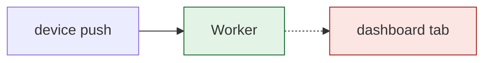

# Walkthrough visuals

Build every interactive walkthrough from `references/walkthrough.html` beside this file. Copy it, then change only the lines between `// DATA START` and `// DATA END`. Keep one running example and one color meaning across the walkthrough and its markdown page.

## Colors

| Class | Chip | Means |
| --- | --- | --- |
| `ex` | `ha` | the running example |
| `ok` | `hg` | added or kept |
| `bad` | `hb` | dropped, refused or broken |
| `risk` | `hw` | a risk or a sign-off item |
| `box` | none | everything else |
| none | none | highlighted map part (accent) |

## Data

```js
// DATA START
const DOC = {
  kicker: 'Factory job 042-queue-batching',      // small caps line above the title
  title: 'Batch ticket writes',                   // h1
  summary: 'One sentence: what changes and why.', // p under the title
  meta: [['Status', 'Spec ready'], ['Job', '042-queue-batching']], // label, value pairs
  example: 'Made-up example: ticket T7 from kiosk K2 at 09:00:12.', // required
};
const MAP = {
  w: 900, h: 340,                                 // SVG viewBox size
  caption: { proposed: 'One sentence.', today: 'One sentence.' },
  nodes: [{ id: 'kiosk', x: 20, y: 40, w: 150, h: 56, label: 'Kiosk K2', sub: 'POST /tickets',
            tone: 'ex', in: ['today', 'proposed'], detail: ['What it does.', 'What changes.'] }],
  edges: [{ from: 'kiosk', to: 'api', label: 'ticket', in: ['today', 'proposed'], tone: 'line' }],
  stages: [{ label: 'Take the ticket', nodes: ['kiosk', 'api'] }],
};
const TABS = [{ id: 'overview', name: 'Overview', steps: [
  { t: 'Step title', v: { kind: 'table', head: ['A'], rows: [['1']] }, b: ['Bullet HTML.'],
    nodes: ['api'], variant: 'proposed', measured: 'optional source text' },
] }];
// DATA END
```

- Mark the running example in `DOC.example` as made up. Put a measured number's source in the step's `measured`.
- Text fields are plain text. Only `b` bullets and the `html` kind take HTML, so HTML-escape code there.

## Map

Draw the whole system once. Give each node an `in` list so Today and Proposed share one layout. List `stages` in the order one cycle runs. Name each step's `nodes` when the step talks about a part of the map. Set `MAP` to `null` when the page has no system to draw.

## Visual kinds

| Kind | Fields | Renders |
| --- | --- | --- |
| `html` | `html` | `innerHTML`; for the hand-drawn patterns in `visuals.md` |
| `timeline` | `from`, `to`, `unit`, `spans: [{from, to, label, tone}]`, `marks: [{at, label}]` | SVG `viewBox="0 0 640 H"`, `H = 50 + 28 * spans.length`; axis at y 24 from x 20 to 620; one span row per span; mark ticks with labels under the axis |
| `heat` | `cols`, `label`, `cells` (0 or 1 each), `legend: [text for 0, text for 1]` | CSS grid of `cols` columns; 0 cell `t-box`, 1 cell `t-ex`; grid has `role="img"` and `aria-label` = `label`; legend line below |
| `cards` | `cards: [{n, label, value, was}]` | flex row of `.card`; `n · label` small, `value` large, `was <was>` small when set; `→` between cards, `aria-hidden` |
| `table` | `head`, `rows` | `<table>`; a cell is a string or `{s, tone}`; a toned cell gets class `t-<tone>` and keeps its word |

## By role

| Role | Walkthrough |
| --- | --- |
| Spec writer | Full map, both variants, stages, every step linked. |
| Builder | The spec's `MAP` unchanged, one step per task group linked to what it built, then before and after, then checks. |
| Reviewer and approver | Only when a finding is easier shown. Reuse the spec's `MAP` when the finding sits on it, else `MAP: null`. |

## Rules

- Paste a pattern into an `html` step as a template literal: `` v: { kind: 'html', html: `<svg class="v" ...>...</svg>` } ``.
  The patterns hold no backtick, no `${` and no single quote, so they paste as is.
- Change only labels, counts and positions. Keep the classes and the 640 wide viewBox.
- Keep each step's visual under 260 px tall and at most 4 bullets.
- HTML-escape code and diff text inside `<text>` and chips: `&amp;`, `&lt;`, `&gt;`.
- Give every `<svg>` an `aria-label` that says what it shows.
- Use synthetic or code-level values only. Load nothing from outside the file.
- Below 720 px the template gives each svg.v a 600 px floor, scrolls it sideways inside its parent, and .pair stacks its cards. Keep those lines when you copy the template.

## Flow

What calls what. Boxes step 225 apart on x. A `cut` arrow marks the broken hop.

```html
<svg class="v" viewBox="0 0 640 120" role="img" aria-label="push reaches the Worker, the dashboard drops the file">
<defs><marker id="ah" viewBox="0 0 8 8" refX="7" refY="4" markerWidth="8" markerHeight="8" orient="auto"><path class="tip" d="M0,0L8,4L0,8z"/></marker></defs>
<rect class="box" x="10" y="35" width="170" height="50" rx="8"/>
<text x="95" y="58" text-anchor="middle">device push</text>
<text class="sub mono" x="95" y="75" text-anchor="middle">factory.py JOB_REL</text>
<line class="line" x1="180" y1="60" x2="233" y2="60" marker-end="url(#ah)"/>
<rect class="ok" x="235" y="35" width="170" height="50" rx="8"/>
<text x="320" y="58" text-anchor="middle">Worker</text>
<text class="sub mono" x="320" y="75" text-anchor="middle">index.js JOB_REL</text>
<line class="cut" x1="405" y1="60" x2="458" y2="60" marker-end="url(#ah)"/>
<rect class="bad" x="460" y="35" width="170" height="50" rx="8"/>
<text x="545" y="58" text-anchor="middle">dashboard tab</text>
<text class="sub mono" x="545" y="75" text-anchor="middle">spec.md only</text>
</svg>
```

## Sequence

Who sends what, in order. Three lanes at x 90, 320 and 550. Messages step 40 down.

```html
<svg class="v" viewBox="0 0 640 180" role="img" aria-label="a frame load gets the page, a tab load is refused">
<defs><marker id="ah" viewBox="0 0 8 8" refX="7" refY="4" markerWidth="8" markerHeight="8" orient="auto"><path class="tip" d="M0,0L8,4L0,8z"/></marker></defs>
<text x="90" y="16" text-anchor="middle">dashboard</text>
<text x="320" y="16" text-anchor="middle">service worker</text>
<text x="550" y="16" text-anchor="middle">Worker</text>
<line class="line" x1="90" y1="24" x2="90" y2="176" stroke-dasharray="3 3"/>
<line class="line" x1="320" y1="24" x2="320" y2="176" stroke-dasharray="3 3"/>
<line class="line" x1="550" y1="24" x2="550" y2="176" stroke-dasharray="3 3"/>
<text class="mono" x="320" y="48" text-anchor="middle">GET build.walkthrough.html (iframe)</text>
<line class="line" x1="90" y1="56" x2="546" y2="56" marker-end="url(#ah)"/>
<text class="mono" x="320" y="88" text-anchor="middle">200, sandbox CSP</text>
<line class="line" x1="550" y1="96" x2="94" y2="96" marker-end="url(#ah)"/>
<text class="mono" x="320" y="128" text-anchor="middle">GET as a new tab</text>
<line class="cut" x1="90" y1="136" x2="546" y2="136" marker-end="url(#ah)"/>
<rect class="bad" x="470" y="146" width="160" height="26" rx="6"/>
<text x="550" y="164" text-anchor="middle">403 frame only</text>
</svg>
```

## Before and after

A change of state, side by side. Plain HTML, so long names wrap.

```html
<div class="pair">
<div class="card"><b>Before</b><span class="chip hb">round-1/review-ui.walkthrough.html</span> 404, never stored</div>
<div class="card"><b>After</b><span class="chip hg">round-1/review-ui.walkthrough.html</span> 200, shown on its tab</div>
</div>
```

## UI mockup

A screen region with numbered callouts. Name each callout number in the bullets.

```html
<svg class="v" viewBox="0 0 640 180" role="img" aria-label="build tab with its own walkthrough bar">
<rect class="box" x="10" y="10" width="620" height="160" rx="10"/>
<rect class="box" x="24" y="22" width="70" height="24" rx="6"/>
<text x="59" y="39" text-anchor="middle">Spec</text>
<rect class="ex" x="100" y="22" width="70" height="24" rx="6"/>
<text x="135" y="39" text-anchor="middle">Build</text>
<rect class="box" x="176" y="22" width="90" height="24" rx="6"/>
<text x="221" y="39" text-anchor="middle">UI review</text>
<rect class="ok" x="24" y="60" width="592" height="36" rx="8"/>
<text x="40" y="83">Interactive walkthrough</text>
<rect class="box" x="540" y="66" width="64" height="24" rx="6"/>
<text x="572" y="83" text-anchor="middle">Show</text>
<rect class="box" x="24" y="110" width="400" height="10" rx="5"/>
<rect class="box" x="24" y="128" width="320" height="10" rx="5"/>
<rect class="box" x="24" y="146" width="360" height="10" rx="5"/>
<circle class="risk" cx="612" cy="60" r="11"/>
<text x="612" y="64" text-anchor="middle">1</text>
</svg>
```

## Markdown pages

The dashboard renders mermaid in strict mode, tables and images, and shows raw HTML
as plain text. Use the counterpart of the same pattern there.

| Pattern | Markdown counterpart |
| --- | --- |
| Flow | mermaid `flowchart LR`, with `classDef ok` and `classDef bad` |
| Sequence | mermaid `sequenceDiagram` |
| Before and after | a table with `Before` and `After` columns |
| UI mockup | a PNG screenshot beside the page, with numbered callouts in a list |
| Map | mermaid flowchart LR of the same nodes |
| timeline | table of spans with from and to |
| heat | table of changed buckets |
| cards | numbered list with before and after values |
| table | the same table with the status word |


